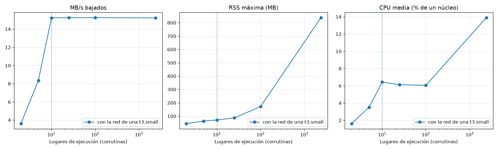
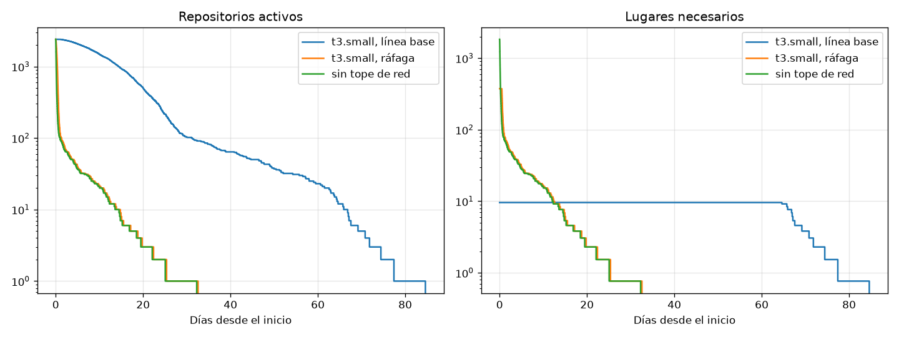

# Prueba de concurrencia: resultados

## Supuestos

- Ancho de banda por conexión: 2,0 MB/s (no medido en los pilotos).
- Latencia hasta los encabezados: log-normal con p50 0.47 s y p95 1.9 s (pilotos).
- Archivos: log-normal con p50 0,53 MB y p95 38,0 MB, cortada en 200,6 MB: media 8,1 MB (pilotos, 51 archivos).
- Intervalo de cortesía: 1.0 s desde el fin de cada pedido.
- Versiones: python 3.12.11, aiohttp 3.14.5, plataforma macOS-26.6.2-arm64-arm-64bit.

## Escenarios

Valores sin el calentamiento. CPU en % de un núcleo; la máquina tiene 2 vCPU en una t3.small.

| Esc. | Modo | Lugares | Repos | Tope de red (MB/s) | Pedidos/s | MB/s | CPU media | CPU máx | RSS máx (MB) | Bucle p99 (ms) | Despacho p99 (ms) | Lat. p50 (ms) | Lat. p95 (ms) | Errores | Violaciones | CPU servidor máx |
|---|---|---|---|---|---|---|---|---|---|---|---|---|---|---|---|---|

Más detalle por escenario:

| Esc. | CPU sistema | CPU ms/pedido | CPU ms/MB | Hilos máx | Descriptores máx | Conexiones máx | Listos sin atender | GC ms/s | Steal % | Deriva RSS (MB/h) | DB tx/s | Commit p95 (ms) |
|---|---|---|---|---|---|---|---|---|---|---|---|---|

## Barrido: cuántas tareas concurrentes convienen

El problema real (2.400 repositorios) con distintas cantidades de lugares de ejecución. La **rodilla** es la menor cantidad de lugares que llega al 95% del máximo: más lugares ya no bajan más rápido, solo esperan. Con pocos lugares, la ocupación alta y el despacho largo son lo esperado: hay más trabajo que lugares.

### Con la red de una t3.small

| Lugares | Ocupación % | Pedidos/s | Ítems/s | MB/s | CPU media | RSS máx (MB) | Bucle p99 (ms) | Despacho p99 (ms) | Errores | Violaciones |
|---|---|---|---|---|---|---|---|---|---|---|
| 2 | 100,0 | 0,5 | 0,16 | 3,6 | 1,6 | 44,7 | 1,97 | 12.721,1 | 0 | 0 |
| 5 | 100,0 | 1,4 | 0,47 | 8,3 | 3,5 | 63,1 | 1,23 | 23.983,2 | 0 | 0 |
| 10 | 100,0 | 2,7 | 1,10 | 15,2 | 6,4 | 71,4 | 1,31 | 28.695,2 | 0 | 0 |
| 25 | 100,0 | 5,0 | 2,16 | 15,3 | 6,1 | 86,9 | 1,06 | 25.821,6 | 0 | 0 |
| 100 | 100,0 | 7,5 | 3,26 | 15,3 | 6,1 | 171,6 | 1,21 | 13.907,6 | 0 | 0 |
| 2400 | 95,7 | 89,6 | 11,63 | 15,2 | 13,9 | 838,2 | 5,37 | 198,2 | 0 | 0 |

- **Rodilla:** con 10 lugares se llega al 95% de los MB/s máximos (15,2 MB/s). Los ítems/s no sirven para esto en corridas cortas: con más lugares se terminan primero los ítems chicos aunque los MB/s sean los mismos; a la larga, ítems/s = MB/s / MB por ítem.
- **Costo de sobrar:** cada lugar de más después de la rodilla suma 328,5 KB de memoria y 0,003 puntos de CPU (2390 lugares de más).

## Proyección al problema real

2400 repositorios y 6 M de ítems repartidos con la regla del simulador del descargador: el repositorio más grande tiene 219,286 ítems, la mediana es 596 y el 4 % más grande concentra el 66,6 %.

Modelo calibrado (cuentas):

- Resolución: latencia media 0,67 s. Descarga: latencia + archivo medio / ancho = 4,52 s. Medido en el escenario de referencia: resolución 0,00 s y descarga 0,00 s.
- Un ítem son 1 resolución y 2,0 descargas: con 1.0 s de cortesía después de cada pedido, ocupa al repositorio 12,7 s y baja 16,2 MB.
- Total a bajar: 97,4 TB.
- **Pico** (todos los repositorios activos): 566 pedidos/s, 2.921 MB/s de demanda y unos 1.834 pedidos en curso.
- **Cota por cortesía:** el repositorio más grande tarda 219,286 × 12,7 s = **32,3 días**, haya una máquina o cien.
- **Cota por red (t3.small, línea base, 15,3 MB/s):** 97,4 TB / red = **70,4 días**. CPU que pide procesar esa red a 0,00 ms de CPU por MB: 0,00 núcleos.
- **Cota por red (t3.small, ráfaga, 596,0 MB/s):** 97,4 TB / red = **1,8 días**. CPU que pide procesar esa red a 0,00 ms de CPU por MB: 0,00 núcleos.

Distribuir solo ayuda si un proceso no llega a procesar lo que da la red de la instancia; si llega, el límite es la red, y se resuelve con una instancia de más red.

### A lo largo de toda la descarga

Modelo de fluido con la distribución de ítems: mientras hay repositorios activos, todos avanzan al ritmo de la cortesía o, si la red no alcanza, a la parte de la red que les toca; los chicos terminan primero. Lugares necesarios: los que pide la cortesía (cada repositorio está ocupado 9,72 s de cada 12,72 s) o los que llenan la red, lo que sea menor.

| Red | Duración (días) | Lugares que llenan la red | Día 0: activos / lugares / MB/s | Día 1: activos / lugares / MB/s | Día 7: activos / lugares / MB/s | Día 14: activos / lugares / MB/s | Día 30: activos / lugares / MB/s | Día 60: activos / lugares / MB/s |
|---|---|---|---|---|---|---|---|---|
| t3.small, línea base | 84,6 | 10 | 2400 / 10 / 15,3 | 2396 / 10 / 15,3 | 1854 / 10 / 15,3 | 1047 / 10 / 15,3 | 103 / 10 / 15,3 | 23 / 10 / 15,3 |
| t3.small, ráfaga | 32,6 | 374 | 2400 / 374 / 596,0 | 116 / 89 / 141,2 | 31 / 24 / 37,7 | 10 / 8 / 12,2 | 1 / 1 / 1,2 | terminó |
| sin tope de red | 32,3 | — | 2400 / 1.834 / 2.921,2 | 100 / 76 / 121,7 | 31 / 24 / 37,7 | 10 / 8 / 12,2 | 1 / 1 / 1,2 | terminó |

## Criterio de decisión

| Escenario | Condición | Resultado |
|---|---|---|
| 4 | Cero violaciones de cortesía y cero errores | sin datos |
| 4 | Retraso de despacho p99 < 100 ms | sin datos |
| 4 | Retraso del bucle p99 < 50 ms | sin datos |
| 4 | CPU media dentro de la línea base de la t3.small (40 % de un núcleo) | sin datos |
| 4 | RSS máxima < 1024 MB | sin datos |
| 4 | El servidor simulado no fue el límite | sin datos |
| 9 | Cero violaciones de cortesía y cero errores | sin datos |
| 9 | Retraso de despacho p99 < 100 ms | sin datos |
| 9 | Retraso del bucle p99 < 50 ms | sin datos |
| 9 | CPU media dentro de la línea base de la t3.small (40 % de un núcleo) | sin datos |
| 9 | RSS máxima < 1024 MB | sin datos |
| 9 | El servidor simulado no fue el límite | sin datos |
| 9 | Memoria estable: deriva < 10% de la RSS media por hora | sin datos |

## Conclusión

_Completar a mano con los números de arriba: si alcanza un proceso con corrutinas, en qué instancia, qué recurso se agota primero y cómo se comparan las corrutinas con los hilos._
