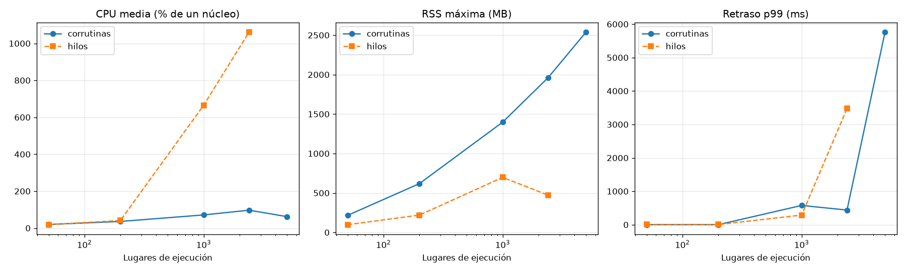

# Prueba de concurrencia: resultados

## Supuestos

- Ancho de banda por conexión: 2,0 MB/s (no medido en los pilotos).
- Latencia hasta los encabezados: log-normal con p50 0.47 s y p95 1.9 s (pilotos).
- Archivos: log-normal con p50 0,53 MB y p95 38,0 MB, cortada en 200,6 MB: media 8,1 MB (pilotos, 51 archivos).
- Intervalo de cortesía: 1.0 s desde el fin de cada pedido.
- Versiones: python 3.12.11, aiohttp 3.14.5, plataforma macOS-26.6.2-arm64-arm-64bit.

## Escenarios

Valores sin el calentamiento. CPU en % de un núcleo; la máquina tiene 2 vCPU en una t3.small.

| Esc. | Modo | Lugares | Repos | Pedidos/s | MB/s | CPU media | CPU máx | RSS máx (MB) | Bucle p99 (ms) | Despacho p99 (ms) | Lat. p50 (ms) | Lat. p95 (ms) | Errores | Violaciones | CPU servidor máx |
|---|---|---|---|---|---|---|---|---|---|---|---|---|---|---|---|
| 1 | corrutinas | 50 | 500 | 25,1 | 26,1 | 19,7 | 29,4 | 216,0 | 1,17 | 14.657,20 | 516,9 | 2.625,2 | 0 | 0 | 18,5 |
| 2 | corrutinas | 200 | 2000 | 111,2 | 116,2 | 36,1 | 40,8 | 618,6 | 0,90 | 13.627,03 | 503,9 | 2.039,6 | 0 | 0 | 28,4 |
| 3 | corrutinas | 1000 | 10000 | 474,8 | 242,7 | 71,4 | 79,9 | 1.397,7 | 576,28 | 14.424,69 | 989,6 | 2.671,0 | 13 | 0 | 90,4 ⚠ |
| 4 | corrutinas | 2400 | 2400 | 576,0 | 434,6 | 97,0 | 97,9 | 1.960,8 | 437,80 | 299,33 | 895,7 | 2.347,5 | 639 | 0 | 78,8 |
| 5 | corrutinas | 5000 | 50000 | 605,3 | 37,6 | 62,2 | 99,8 | 2.538,6 | 5.761,55 | 24.211,04 | 3.468,2 | 4.816,5 | 9210 | 0 | 80,2 |
| 6 | corrutinas | 2400 | 2400 | 360,7 | 501,2 | 97,1 | 98,4 | 2.065,6 | 452,65 | 451,47 | 1.529,0 | 3.222,6 | 4752 | 5 | 96,5 ⚠ |
| 7 | hilos | 2400 | 2400 | 6,0 | 0,1 | 1.061,2 | 2.835,8 | 473,0 | 3.474,56 | 1.423,27 | 0,0 | 0,0 | 0 | 0 | 23,1 |
| 9 | corrutinas | 2400 | 2400 | 692,2 | 546,2 | 95,5 | 96,4 | 2.044,9 | 456,46 | 291,02 | 1.094,1 | 2.711,9 | 2096 | 0 | 81,2 |
| 1h | hilos | 50 | 500 | 24,9 | 27,1 | 18,7 | 20,9 | 98,5 | 5,10 | 13.828,44 | 523,8 | 1.988,0 | 0 | 0 | 16,8 |
| 2h | hilos | 200 | 2000 | 109,1 | 115,6 | 41,2 | 45,2 | 219,6 | 5,07 | 14.276,44 | 475,0 | 2.027,0 | 0 | 0 | 29,8 |
| 3h | hilos | 1000 | 10000 | 492,0 | 123,3 | 665,5 | 965,8 | 697,8 | 287,80 | 14.468,74 | 971,2 | 3.403,2 | 1237 | 0 | 75,8 |

Más detalle por escenario:

| Esc. | CPU sistema | CPU ms/pedido | CPU ms/MB | Hilos máx | Descriptores máx | Conexiones máx | Listos sin atender | GC ms/s | Steal % | Deriva RSS (MB/h) | DB tx/s | Commit p95 (ms) |
|---|---|---|---|---|---|---|---|---|---|---|---|---|
| 1 | 3,8 | 7,85 | 7,58 | 1 | 407 | 399 | 422,2 | 1,39 | 0,00 | -5.014,3 | 0,0 | 0,00 |
| 2 | 6,4 | 3,25 | 3,11 | 1 | 1660 | 1650 | 1.664,2 | 2,64 | 0,00 | 24.581,3 | 0,0 | 0,00 |
| 3 | 14,8 | 1,50 | 2,94 | 1 | 8273 | 8235 | 8.487,6 | 62,16 | 0,00 | 24.618,8 | 0,0 | 0,00 |
| 4 | 18,9 | 1,68 | 2,23 | 1 | 2315 | 2304 | 42,7 | 46,37 | 0,00 | -13.590,8 | 0,0 | 0,00 |
| 5 | 12,9 | 1,03 | 16,53 | 1 | 14052 | 13676 | 44.938,4 | 168,34 | 0,00 | -225.252,8 | 0,0 | 0,00 |
| 6 | 18,8 | 2,69 | 1,94 | 1 | 2286 | 2082 | 19,4 | 59,97 | 0,00 | -82.202,2 | 0,0 | 0,00 |
| 7 | 1.033,1 | 1.767,37 | 108.759,00 | 2405 | 2394 | 2391 | 76,1 | 1.145,44 | 0,00 | 10.126,0 | 0,0 | 0,00 |
| 9 | 17,8 | 1,38 | 1,75 | 1 | 2272 | 2135 | 41,7 | 54,04 | 0,00 | 82.985,0 | 0,0 | 0,00 |
| 1h | 4,0 | 7,50 | 6,90 | 55 | 503 | 500 | 421,5 | 0,47 | 0,00 | 156,7 | 0,0 | 0,00 |
| 2h | 10,1 | 3,78 | 3,57 | 205 | 1993 | 1989 | 1.671,8 | 1,64 | 0,00 | 3.457,5 | 0,0 | 0,00 |
| 3h | 487,9 | 13,53 | 53,97 | 1005 | 8750 | 8747 | 8.453,7 | 54,85 | 0,00 | 10.949,0 | 0,0 | 0,00 |

⚠ En los escenarios 3, 6 el servidor simulado pasó el 90 % de un núcleo: el límite pudo ser él y no el motor. Sus números son una cota inferior de lo que aguanta el motor.

Errores por tipo: `{"3": {"ClientPayloadError": 13}, "4": {"ClientPayloadError": 638, "ServerDisconnectedError": 1}, "5": {"ClientConnectorError": 9210}, "6": {"ClientPayloadError": 4748, "ClientConnectorError": 2, "ServerDisconnectedError": 2}, "9": {"ClientPayloadError": 2091, "ServerDisconnectedError": 5}, "3h": {"ConnectionError": 1237}}`

## Gráficos

## Proyección al problema real

2400 repositorios y 6 M de ítems repartidos con la regla del simulador del descargador: el repositorio más grande tiene 219,286 ítems, la mediana es 596 y el 4 % más grande concentra el 66,6 %.

Modelo calibrado (cuentas):

- Resolución: latencia media 0,67 s. Descarga: latencia + archivo medio / ancho = 4,52 s. Medido en el escenario de referencia: resolución 1,20 s y descarga 2,06 s.
- Un ítem son 1 resolución y 2,0 descargas: con 1.0 s de cortesía después de cada pedido, ocupa al repositorio 12,7 s y baja 16,2 MB.
- Total a bajar: 97,4 TB.
- **Pico** (todos los repositorios activos): 566 pedidos/s, 2.921 MB/s de demanda y unos 1.834 pedidos en curso.
- **Cota por cortesía:** el repositorio más grande tarda 219,286 × 12,7 s = **32,3 días**, haya una máquina o cien.
- **Cota por red (t3.small, línea base, 15,3 MB/s):** 97,4 TB / red = **70,4 días**. CPU que pide procesar esa red a 2,23 ms de CPU por MB: 0,03 núcleos.
- **Cota por red (t3.small, ráfaga, 596,0 MB/s):** 97,4 TB / red = **1,8 días**. CPU que pide procesar esa red a 2,23 ms de CPU por MB: 1,33 núcleos.
- **Capacidad medida de un proceso con corrutinas:** 116,2 MB/s en el escenario 2.

La duración real es la mayor de las cotas. Distribuir solo ayuda si un proceso no llega a procesar lo que da la red de la instancia; si llega, el límite es la red, y se resuelve con una instancia de más red.

## Criterio de decisión

| Escenario | Condición | Resultado |
|---|---|---|
| 4 | Cero violaciones de cortesía y cero errores | **no cumple** |
| 4 | Retraso de despacho p99 < 100 ms | **no cumple** |
| 4 | Retraso del bucle p99 < 50 ms | **no cumple** |
| 4 | CPU media dentro de la línea base de la t3.small (40 % de un núcleo) | **no cumple** |
| 4 | RSS máxima < 1024 MB | **no cumple** |
| 4 | El servidor simulado no fue el límite | cumple |
| 9 | Cero violaciones de cortesía y cero errores | **no cumple** |
| 9 | Retraso de despacho p99 < 100 ms | **no cumple** |
| 9 | Retraso del bucle p99 < 50 ms | **no cumple** |
| 9 | CPU media dentro de la línea base de la t3.small (40 % de un núcleo) | **no cumple** |
| 9 | RSS máxima < 1024 MB | **no cumple** |
| 9 | El servidor simulado no fue el límite | cumple |
| 9 | Memoria estable: deriva < 10% de la RSS media por hora | **no cumple** |

## Conclusión

_Completar a mano con los números de arriba: si alcanza un proceso con corrutinas, en qué instancia, qué recurso se agota primero y cómo se comparan las corrutinas con los hilos._
