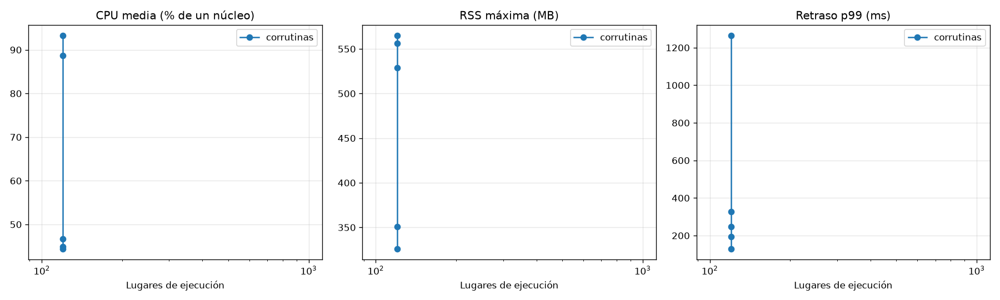
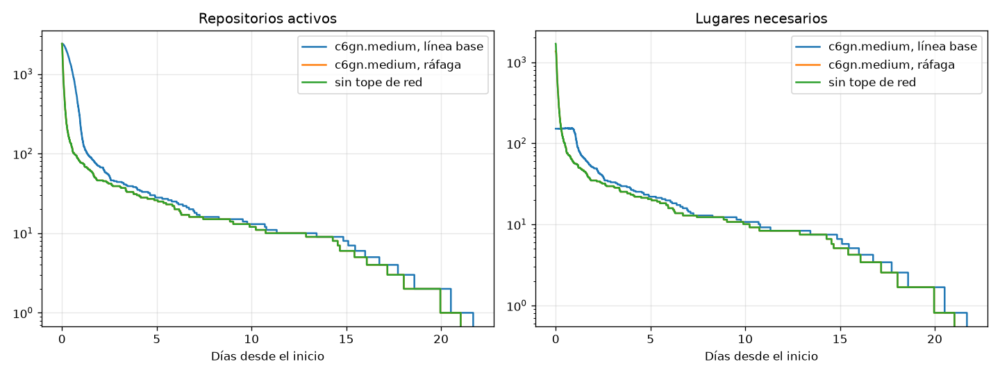

# Prueba de concurrencia: resultados

## Instancia

- **tipo:** c6gn.medium
- **zona:** us-east-1a
- **vcpu:** 1
- **memoria_mb:** 1823
- **kernel:** 7.0.0-1014-aws
- **docker:** 29.1.3
- **servidor_simulado:** 172.31.11.186, 2 procesos
- **s3:** s3://prueba-concurrencia-mateo-2026

## Supuestos

- Velocidad por conexión: 2,1 MB/s. Es el supuesto que más mueve la duración: ver la tabla de sensibilidad en la proyección (y `relevamiento medir-velocidad` para medirla).
- Latencia hasta los encabezados: log-normal con p50 0.47 s y p95 1.9 s (pilotos).
- Archivos: log-normal con p50 0,53 MB y p95 38,0 MB, cortada en 200,6 MB: media 8,1 MB (pilotos, 51 archivos).
- Intervalo de cortesía: 1.0 s desde el fin de cada pedido.
- Versiones: python 3.12.16, aiohttp 3.14.5, plataforma Linux-7.0.0-1014-aws-aarch64-with-glibc2.41.

## Escenarios

Instancia simulada: **c6gn.medium** (1 vCPU, 2 GB, red base 190,7 MB/s). Valores sin el calentamiento; CPU en % de un núcleo.

| Esc. | Modo | Lugares | Repos | Tope de red (MB/s) | Pedidos/s | MB/s | CPU media | CPU máx | RSS máx (MB) | Bucle p99 (ms) | Despacho p99 (ms) | Lat. p50 (ms) | Lat. p95 (ms) | Errores | Violaciones | CPU servidor máx |
|---|---|---|---|---|---|---|---|---|---|---|---|---|---|---|---|---|
| b120 | corrutinas | 120 | 2400 | 190,7 | 36,6 | 186,0 | 93,3 | 101,2 | 351,1 | 247,37 | 182.577,62 | 644,0 | 2.078,3 | 0 | 0 | 40,9 |
| s120 | corrutinas | 120 | 2400 | 190,7 | 17,0 | 79,3 | 44,9 | 76,5 | 528,6 | 1.264,48 | 208.987,82 | 1.498,1 | 3.384,1 | 0 | 0 | 27,0 |
| v120 | corrutinas + db | 120 | 2400 | 190,7 | 16,8 | 80,5 | 45,3 | 80,4 | 381,2 | 681,37 | 203.291,46 | 815,5 | 2.402,1 | 22 | 0 | 101,0 ⚠ |
| b120-host | corrutinas | 120 | 2400 | 190,7 | 37,1 | 188,6 | 88,6 | 97,8 | 326,1 | 130,03 | 180.402,50 | 525,1 | 1.916,6 | 0 | 0 | 36,0 |
| s120-host | corrutinas | 120 | 2400 | 190,7 | 18,9 | 85,4 | 44,4 | 79,2 | 556,5 | 327,33 | 208.491,77 | 605,2 | 1.973,6 | 0 | 0 | 28,0 |
| v120-host | corrutinas + db | 120 | 2400 | 190,7 | 19,3 | 86,3 | 45,0 | 70,6 | 539,8 | 314,50 | 208.752,65 | 626,4 | 1.969,3 | 0 | 0 | 29,0 |
| s120-host-crt | corrutinas | 120 | 2400 | 190,7 | 18,9 | 85,7 | 46,7 | 71,1 | 565,0 | 195,01 | 208.437,09 | 551,2 | 2.055,8 | 0 | 0 | 24,0 |

Más detalle por escenario:

| Esc. | CPU sistema | CPU ms/pedido | CPU ms/MB | Hilos máx | Descriptores máx | Conexiones máx | Listos sin atender | GC ms/s | Steal % | Deriva RSS (MB/h) | DB tx/s | Commit p95 (ms) |
|---|---|---|---|---|---|---|---|---|---|---|---|---|
| b120 | 45,5 | 25,52 | 5,01 | 1 | 496 | 487 | 2.242,2 | 2,96 | 0,00 | 336,1 | 0,0 | 0,00 |
| s120 | 18,7 | 26,50 | 5,67 | 6 | 382 | 307 | 2.264,4 | 10,05 | 0,00 | 1.028,1 | 0,0 | 0,00 |
| v120 | 16,4 | 26,91 | 5,62 | 6 | 336 | 316 | 2.313,7 | 7,80 | 0,00 | 1.356,2 | 16,8 | 1.378,41 |
| b120-host | 22,4 | 23,89 | 4,70 | 1 | 552 | 545 | 2.239,9 | 2,06 | 0,00 | 125,8 | 0,0 | 0,00 |
| s120-host | 12,6 | 23,45 | 5,20 | 6 | 482 | 397 | 2.262,0 | 6,71 | 0,00 | 1.257,7 | 0,0 | 0,00 |
| v120-host | 14,5 | 23,33 | 5,21 | 6 | 448 | 409 | 2.260,7 | 6,15 | 0,00 | 182,4 | 0,8 | 196,29 |
| s120-host-crt | 14,9 | 24,65 | 5,45 | 6 | 486 | 394 | 2.261,2 | 6,76 | 0,00 | 597,3 | 0,0 | 0,00 |

⚠ En los escenarios v120 el servidor simulado pasó el 90 % de un núcleo: el límite pudo ser él y no el motor. Sus números son una cota inferior de lo que aguanta el motor.

Errores por tipo: `{"v120": {"ConnectionTimeoutError": 22}}`

## Gráficos

## Subida a S3

El motor guarda cada archivo mientras lo baja (los de menos de 8 MB en el spool en RAM, los demás en disco) y, al terminar, lo deja para un proceso subidor aparte (boto3, en su propio núcleo) que lo sube a un S3 falso local. Si lo pendiente pasa 256 MB en RAM o 4.096 MB en disco, el motor deja de repartir tareas nuevas ("frenado"). **Lo que importa: frenado en 0 y lo pendiente estable** quieren decir que la descarga nunca esperó a la subida.

| Esc. | Dónde sube | Lugares | Tope de red | MB/s bajados | MB/s subidos | CPU motor | CPU motor sin subida | RSS motor (MB) | CPU subidor (media / máx) | RSS subidor (MB) | Pendiente máx RAM / disco (MB) | Frenado (s) | Escritura a disco (MB/s) | Objetos (multipart) | Errores de subida | Pendiente al final (MB) |
|---|---|---|---|---|---|---|---|---|---|---|---|---|---|---|---|---|
| s120 | proceso aparte, mismo núcleo que el motor (16) | 120 | 190,7 | 79,3 | 69,3 | 44,9 | 93,3 (b120) | 529 | 42,9 / 79,1 | 113 | 102 / 509 | 0,0 | 68,4 | 2675 (0) | 0 | 192 |
| v120 | proceso aparte, mismo núcleo que el motor (16) | 120 | 190,7 | 80,5 | 75,7 | 45,3 | 93,3 (b120) | 381 | 46,9 / 74,2 | 117 | 36 / 444 | 0,0 | 67,9 | 2516 (0) | 0 | 0 |
| s120-host | proceso aparte, mismo núcleo que el motor (16) | 120 | 190,7 | 85,4 | 65,0 | 44,4 | 93,3 (b120) | 556 | 35,5 / 57,0 | 114 | 44 / 302 | 0,0 | 72,2 | 2987 (0) | 0 | 57 |
| v120-host | proceso aparte, mismo núcleo que el motor (16) | 120 | 190,7 | 86,3 | 64,7 | 45,0 | 93,3 (b120) | 540 | 31,2 / 53,4 | 118 | 46 / 447 | 0,0 | 73,2 | 3015 (0) | 0 | 436 |
| s120-host-crt | proceso aparte, CRT, mismo núcleo que el motor (16) | 120 | 190,7 | 85,7 | 62,9 | 46,7 | 93,3 (b120) | 565 | 26,2 / 42,3 | 258 | 48 / 880 | 0,0 | 73,7 | 2984 (0) | 0 | 179 |

- **Dónde sube:** proceso aparte (en su propio núcleo), un pool de hilos con s3transfer dentro del proceso del motor, o un pool de corrutinas con aiobotocore dentro del bucle del motor. Entre paréntesis, las subidas a la vez. El spool es el mismo en los tres: la única diferencia es dónde corre la subida.
- **CPU motor contra la referencia sin subida:** en proceso aparte, lo que le agrega al motor escribir el spool; con hilos o corrutinas, además todo el costo de subir, que comparte el núcleo (y el GIL) con la descarga. Si la CPU llega al 100 %, bajan los MB/s bajados y sube el retraso del bucle.
- **CPU del subidor:** solo se ve aparte en el proceso aparte. Con el SDK CRT de AWS sería menos.
- **Escritura a disco:** de toda la máquina; es lo que tiene que sostener el volumen EBS del spool (gp3 da 125 MB/s de base) y el tope de EBS de la instancia.
- En corridas cortas pasan sobre todo los archivos chicos: los grandes no llegan a terminar de bajar, así que el spool en disco aparece menos de lo que se usaría en la descarga real.

## Validación en una c6gn.medium real

El motor corre en una **c6gn.medium real**, en Docker Compose junto con PostgreSQL, y le pide a un servidor simulado que corre en **otra instancia** de la misma subred: el tráfico pasa por la placa de red real, el spool en disco escribe en el EBS real y todo comparte la memoria real de la máquina. La subida va a **S3 real**. La CPU y la memoria de la máquina incluyen todo lo que corre en ella (motor, subidor, PostgreSQL y Docker).

| Esc. | Red de Docker | Base | Subida | MB/s bajados | MB/s subidos | CPU máquina (media / máx) | CPU motor (sistema) | Bucle p99 (ms) | Despacho p99 (ms) | Frenado (s) | Pendiente al final (MB) | Errores (descarga / subida) | Violaciones |
|---|---|---|---|---|---|---|---|---|---|---|---|---|---|
| b120 | puente | no | no | 186,0 | — | 99,9 / 100,0 | 93,3 (45,5) | 247,37 | 182.577,6 | 0,0 | — | 0 / 0 | 0 |
| s120 | puente | no | S3 real | 79,3 | 69,3 | 100,0 / 100,0 | 44,9 (18,7) | 1.264,48 | 208.987,8 | 0,0 | 192 | 0 / 0 | 0 |
| v120 | puente | por resultado | S3 real | 80,5 | 75,7 | 100,0 / 100,0 | 45,3 (16,4) | 681,37 | 203.291,5 | 0,0 | 0 | 22 / 0 | 0 |
| b120-host | host | no | no | 188,6 | — | 95,0 / 99,1 | 88,6 (22,4) | 130,03 | 180.402,5 | 0,0 | — | 0 / 0 | 0 |
| s120-host | host | no | S3 real | 85,4 | 65,0 | 100,0 / 100,0 | 44,4 (12,6) | 327,33 | 208.491,8 | 0,0 | 57 | 0 / 0 | 0 |
| v120-host | host | en lotes | S3 real | 86,3 | 64,7 | 100,0 / 100,0 | 45,0 (14,5) | 314,50 | 208.752,6 | 0,0 | 436 | 0 / 0 | 0 |
| s120-host-crt | host | no | S3 real (CRT) | 85,7 | 62,9 | 100,0 / 100,0 | 46,7 (14,9) | 195,01 | 208.437,1 | 0,0 | 179 | 0 / 0 | 0 |

| Esc. | Memoria disponible mín (MB) | Pico contenedor motor (MB) | Pico PostgreSQL (MB) | RSS motor máx (MB) | RSS subidor máx (MB) | Escritura a disco (media / máx, MB/s) | DB tx/s (filas/s) | Commit p95 (ms) | Deriva memoria disponible (MB/h) |
|---|---|---|---|---|---|---|---|---|---|
| b120 | 914 de 1.823 | 360 | 29 | 351 | — | 0,0 / 1,6 | 0,0 (0,0) | 0,00 | — |
| s120 | 472 de 1.823 | 688 | 30 | 529 | 113 | 68,4 / 136,9 | 0,0 (0,0) | 0,00 | — |
| v120 | 631 de 1.823 | — | — | 381 | 117 | 67,9 / 153,0 | 16,8 (16,8) | 1.378,41 | — |
| b120-host | 942 de 1.823 | 319 | 24 | 326 | — | 0,0 / 1,4 | 0,0 (0,0) | 0,00 | — |
| s120-host | 543 de 1.823 | 773 | 23 | 556 | 114 | 72,2 / 124,9 | 0,0 (0,0) | 0,00 | — |
| v120-host | 517 de 1.823 | 763 | 39 | 540 | 118 | 73,2 / 119,5 | 0,8 (19,4) | 196,29 | — |
| s120-host-crt | 411 de 1.823 | 924 | 21 | 565 | 258 | 73,7 / 126,0 | 0,0 (0,0) | 0,00 | — |

- **Red de Docker:** `puente` es la red por defecto de Docker (cada paquete pasa por una interfaz virtual y NAT); `host`, el motor usa la red de la máquina directamente. La diferencia de CPU es lo que cuesta el puente.
- **Base:** `por resultado`, una transacción por resultado que el lugar espera antes de tomar otra tarea; `en lotes`, como el descargador, el lugar encola y sigue, y una tarea aparte escribe lo encolado cada 1 s. **Subida (CRT):** el cliente de S3 de AWS escrito en C en vez de s3transfer.
- **CPU máquina:** % de toda la instancia (en una de 1 vCPU, 100 % es el núcleo entero). Es lo que importa para saber si entra todo: motor, subidor, PostgreSQL y Docker.
- **Memoria disponible mínima:** la que le quedó libre a la máquina en el peor segundo. El pico del contenedor del motor incluye el spool en RAM (`/dev/shm`) y el subidor; el de PostgreSQL, sus buffers.
- **Escritura a disco:** del EBS real. Si se acerca al tope de EBS de la instancia (o a los 125 MB/s de base de un gp3), el spool en disco se atrasa y lo pendiente crece; en corridas cortas cuenta la ráfaga de EBS.
- **Deriva:** solo en corridas de 10 minutos o más (la de 1 hora). Negativa quiere decir que la memoria disponible baja; el caché de páginas del disco también la baja sin que sea una pérdida.

## Proyección al problema real

2400 repositorios y 6 M de ítems repartidos con la regla del simulador del descargador: el repositorio más grande tiene 219,286 ítems, la mediana es 596 y el 4 % más grande concentra el 66,6 %.

Modelo calibrado (cuentas):

- Resolución: latencia media 0,67 s. Descarga: latencia + archivo medio / ancho = 4,25 s. Medido en el escenario de referencia: resolución 0,00 s y descarga 0,00 s.
- Un ítem son 1 resolución y 2,0 descargas: con 1.0 s de cortesía después de cada pedido, ocupa al repositorio 12,2 s y baja 16,2 MB.
- Total a bajar: 97,4 TB.
- **Pico** (todos los repositorios activos): 591 pedidos/s, 3.050 MB/s de demanda y unos 1.809 pedidos en curso.
- **Cota por cortesía:** el repositorio más grande tarda 219,286 × 12,2 s = **30,9 días**, haya una máquina o cien.
- **Cota por red (c6gn.medium, línea base, 190,7 MB/s):** 97,4 TB / red = **5,6 días**. CPU que pide procesar esa red a 4,70 ms de CPU por MB: 0,90 núcleos.
- **Cota por red (c6gn.medium, ráfaga, 1.907,3 MB/s):** 97,4 TB / red = **0,6 días**. CPU que pide procesar esa red a 4,70 ms de CPU por MB: 8,96 núcleos.

Distribuir solo ayuda si un proceso no llega a procesar lo que da la red de la instancia; si llega, el límite es la red, y se resuelve con una instancia de más red.

### A lo largo de toda la descarga

Modelo de fluido con la distribución de ítems: mientras hay repositorios activos, todos avanzan al ritmo de la cortesía o, si la red no alcanza, a la parte de la red que les toca; los chicos terminan primero. Lugares necesarios: los que pide la cortesía (cada repositorio está ocupado 9,18 s de cada 12,18 s) o los que llenan la red, lo que sea menor.

| Red | Duración (días) | Lugares que llenan la red | Día 0: activos / lugares / MB/s | Día 1: activos / lugares / MB/s | Día 7: activos / lugares / MB/s | Día 14: activos / lugares / MB/s | Día 30: activos / lugares / MB/s | Día 60: activos / lugares / MB/s |
|---|---|---|---|---|---|---|---|---|
| c6gn.medium, línea base | 32,6 | 113 | 2400 / 113 / 190,7 | 1217 / 113 / 190,7 | 33 / 25 / 41,9 | 12 / 9 / 15,2 | 1 / 1 / 1,3 | terminó |
| c6gn.medium, ráfaga | 30,9 | 1.131 | 2400 / 1.131 / 1.907,3 | 98 / 74 / 124,5 | 30 / 23 / 38,1 | 9 / 7 / 11,4 | 1 / 1 / 1,3 | terminó |
| sin tope de red | 30,9 | — | 2400 / 1.809 / 3.050,0 | 97 / 73 / 123,3 | 30 / 23 / 38,1 | 9 / 7 / 11,4 | 1 / 1 / 1,3 | terminó |

### Sensibilidad a la velocidad por conexión

Como cada repositorio recibe un pedido a la vez, si sus archivos llegan más lento avanza más lento, y el repositorio más grande tarda más: ninguna máquina ni más red compensa eso. Con la red de la c6gn.medium:

| MB/s por conexión | Tiempo por ítem (s) | Repositorio más grande (días) | Duración total (días) | Corrutinas que llenan la red |
|---|---|---|---|---|
| 0,5 | 35,8 | 90,9 | 91,9 | 404 |
| 1,0 | 20,4 | 51,8 | 53,2 | 215 |
| 2,0 | 12,7 | 32,3 | 33,9 | 120 |
| 2,1 ← esta corrida | 12,2 | 30,9 | 32,6 | 113 |
| 5,0 | 8,1 | 20,6 | 22,4 | 63 |

### Instancias candidatas

Para cada instancia, con su red base: duración del modelo, corrutinas que llenan la red, MB/s al principio, CPU que pide procesarlos (4,70 ms de CPU por MB, medidos en el escenario b120-host en la máquina de esta corrida: vale para ese mismo tipo de procesador), memoria según el barrido y costo on-demand en us-east-1 por toda la descarga. Precios y redes de config.INSTANCIAS: verificar antes de decidir.

| Instancia | vCPU / RAM | Red base (MB/s) | $/h | Duración (días) | Corrutinas | MB/s | CPU (% de un núcleo) | Memoria (MB) | Costo total |
|---|---|---|---|---|---|---|---|---|---|
| t3.small | 2 / 2 GB | 15,3 | 0,0208 | 83,8 | 9 | 15,3 | 7,2 | — | $42 |
| t3.medium | 2 / 4 GB | 30,5 | 0,0416 | 52,2 | 18 | 30,5 | 14,3 | — | $52 |
| t3.large | 2 / 8 GB | 61,0 | 0,0832 | 38,8 | 36 | 61,0 | 28,7 | — | $77 |
| t3.xlarge | 4 / 16 GB | 122,1 | 0,1664 | 33,9 | 72 | 122,1 | 57,4 | — | $135 |
| c7g.medium | 1 / 2 GB | 62,0 | 0,0363 | 38,6 | 37 | 62,0 | 29,1 | — | $34 |
| c7g.large | 2 / 4 GB | 111,7 | 0,0725 | 34,2 | 66 | 111,7 | 52,5 | — | $60 |
| c6i.large | 2 / 4 GB | 93,1 | 0,0850 | 35,2 | 55 | 93,1 | 43,8 | — | $72 |
| c6gn.medium ← | 1 / 2 GB | 190,7 | 0,0432 | 32,6 | 113 | 190,7 | 89,6 ⚠ | — | $34 |
| c6gn.large | 2 / 4 GB | 357,6 | 0,0864 | 31,6 | 212 | 357,6 | 168,1 ⚠ | — | $66 |
| c7gn.medium | 1 / 2 GB | 372,5 | 0,0624 | 31,6 | 221 | 372,5 | 175,1 ⚠ | — | $47 |

⚠: la CPU que pide pasa lo que la instancia sostiene (línea base de créditos en las t3; 80 % de un núcleo en las demás, porque un proceso de Python usa uno solo).

## Criterio de decisión

| Escenario | Condición | Resultado |
|---|---|---|
| 4 | Cero violaciones de cortesía y cero errores | sin datos |
| 4 | Retraso de despacho p99 < 100 ms | sin datos |
| 4 | Retraso del bucle p99 < 50 ms | sin datos |
| 4 | CPU media < 80 % de un núcleo (un proceso usa uno; margen para Postgres) | sin datos |
| 4 | RSS máxima < 1024 MB | sin datos |
| 4 | El servidor simulado no fue el límite | sin datos |
| 9 | Cero violaciones de cortesía y cero errores | sin datos |
| 9 | Retraso de despacho p99 < 100 ms | sin datos |
| 9 | Retraso del bucle p99 < 50 ms | sin datos |
| 9 | CPU media < 80 % de un núcleo (un proceso usa uno; margen para Postgres) | sin datos |
| 9 | RSS máxima < 1024 MB | sin datos |
| 9 | El servidor simulado no fue el límite | sin datos |
| 9 | Memoria estable: deriva < 10% de la RSS media por hora | sin datos |

## Conclusión

_Completar a mano con los números de arriba: si alcanza un proceso con corrutinas, en qué instancia, qué recurso se agota primero y cómo se comparan las corrutinas con los hilos._
