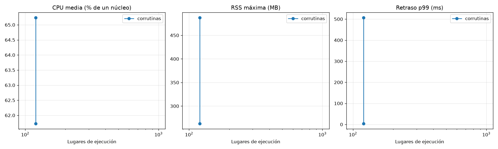
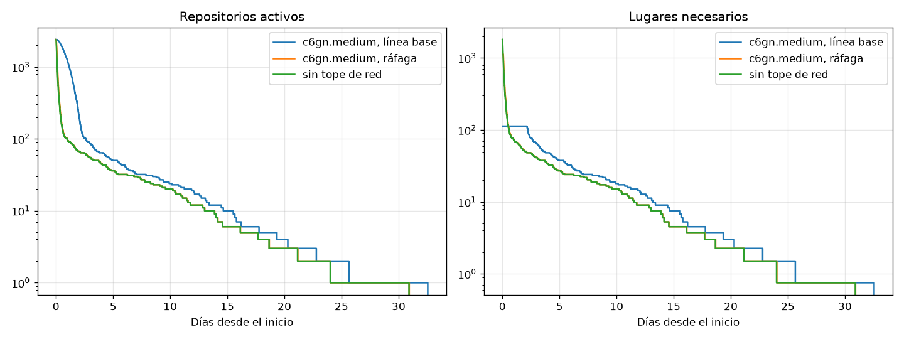

# Prueba de concurrencia: resultados

## Supuestos

- Velocidad por conexión: 2,1 MB/s. Es el supuesto que más mueve la duración: ver la tabla de sensibilidad en la proyección (y `relevamiento medir-velocidad` para medirla).
- Latencia hasta los encabezados: log-normal con p50 0.47 s y p95 1.9 s (pilotos).
- Archivos: log-normal con p50 0,53 MB y p95 38,0 MB, cortada en 200,6 MB: media 8,1 MB (pilotos, 51 archivos).
- Intervalo de cortesía: 1.0 s desde el fin de cada pedido.
- Versiones: python 3.12.3, aiohttp 3.14.5, plataforma Linux-7.0.0-1014-aws-aarch64-with-glibc2.39.

## Escenarios

Instancia simulada: **c6gn.medium** (1 vCPU, 2 GB, red base 190,7 MB/s). Valores sin el calentamiento; CPU en % de un núcleo.

| Esc. | Modo | Lugares | Repos | Tope de red (MB/s) | Pedidos/s | MB/s | CPU media | CPU máx | RSS máx (MB) | Bucle p99 (ms) | Despacho p99 (ms) | Lat. p50 (ms) | Lat. p95 (ms) | Errores | Violaciones | CPU servidor máx |
|---|---|---|---|---|---|---|---|---|---|---|---|---|---|---|---|---|
| b120 | corrutinas | 120 | 2400 | 190,7 | 40,5 | 174,7 | 65,2 | 72,9 | 263,0 | 4,30 | 68.957,90 | 499,4 | 1.915,5 | 0 | 0 | 25,0 |
| s120 | corrutinas | 120 | 2400 | 190,7 | 33,8 | 155,2 | 61,7 | 80,9 | 487,4 | 506,84 | 68.542,45 | 988,2 | 2.421,3 | 0 | 0 | 25,0 |

Más detalle por escenario:

| Esc. | CPU sistema | CPU ms/pedido | CPU ms/MB | Hilos máx | Descriptores máx | Conexiones máx | Listos sin atender | GC ms/s | Steal % | Deriva RSS (MB/h) | DB tx/s | Commit p95 (ms) |
|---|---|---|---|---|---|---|---|---|---|---|---|---|
| b120 | 7,6 | 16,11 | 3,73 | 1 | 536 | 465 | 2.237,0 | 1,64 | 0,00 | 4.609,0 | 0,0 | 0,00 |
| s120 | 10,9 | 18,27 | 3,98 | 9 | 537 | 467 | 2.244,7 | 8,41 | 0,00 | 6.519,2 | 0,0 | 0,00 |

## Gráficos

## Subida a S3

El motor guarda cada archivo mientras lo baja (los de menos de 8 MB en el spool en RAM, los demás en disco) y, al terminar, lo deja para un proceso subidor aparte (boto3, en su propio núcleo) que lo sube a un S3 falso local. Si lo pendiente pasa 256 MB en RAM o 4.096 MB en disco, el motor deja de repartir tareas nuevas ("frenado"). **Lo que importa: frenado en 0 y lo pendiente estable** quieren decir que la descarga nunca esperó a la subida.

| Esc. | Dónde sube | Lugares | Tope de red | MB/s bajados | MB/s subidos | CPU motor | CPU motor sin subida | RSS motor (MB) | CPU subidor (media / máx) | RSS subidor (MB) | Pendiente máx RAM / disco (MB) | Frenado (s) | Escritura a disco (MB/s) | Objetos (multipart) | Errores de subida | Pendiente al final (MB) |
|---|---|---|---|---|---|---|---|---|---|---|---|---|---|---|---|---|
| s120 | proceso aparte, mismo núcleo que el motor (16) | 120 | 190,7 | 155,2 | 109,7 | 61,7 | 65,2 (b120) | 487 | 38,6 / 67,4 | 96 | 30 / 214 | 0,0 | 106,8 | 1756 (210) | 0 | 0 |

- **Dónde sube:** proceso aparte (en su propio núcleo), un pool de hilos con s3transfer dentro del proceso del motor, o un pool de corrutinas con aiobotocore dentro del bucle del motor. Entre paréntesis, las subidas a la vez. El spool es el mismo en los tres: la única diferencia es dónde corre la subida.
- **CPU motor contra la referencia sin subida:** en proceso aparte, lo que le agrega al motor escribir el spool; con hilos o corrutinas, además todo el costo de subir, que comparte el núcleo (y el GIL) con la descarga. Si la CPU llega al 100 %, bajan los MB/s bajados y sube el retraso del bucle.
- **CPU del subidor:** solo se ve aparte en el proceso aparte. Con el SDK CRT de AWS sería menos.
- **Escritura a disco:** de toda la máquina; es lo que tiene que sostener el volumen EBS del spool (gp3 da 125 MB/s de base) y el tope de EBS de la instancia.
- En corridas cortas pasan sobre todo los archivos chicos: los grandes no llegan a terminar de bajar, así que el spool en disco aparece menos de lo que se usaría en la descarga real.

## Proyección al problema real

2400 repositorios y 6 M de ítems repartidos con la regla del simulador del descargador: el repositorio más grande tiene 219,286 ítems, la mediana es 596 y el 4 % más grande concentra el 66,6 %.

Modelo calibrado (cuentas):

- Resolución: latencia media 0,67 s. Descarga: latencia + archivo medio / ancho = 4,25 s. Medido en el escenario de referencia: resolución 0,00 s y descarga 0,00 s.
- Un ítem son 1 resolución y 2,0 descargas: con 1.0 s de cortesía después de cada pedido, ocupa al repositorio 12,2 s y baja 16,2 MB.
- Total a bajar: 97,4 TB.
- **Pico** (todos los repositorios activos): 591 pedidos/s, 3.050 MB/s de demanda y unos 1.809 pedidos en curso.
- **Cota por cortesía:** el repositorio más grande tarda 219,286 × 12,2 s = **30,9 días**, haya una máquina o cien.
- **Cota por red (c6gn.medium, línea base, 190,7 MB/s):** 97,4 TB / red = **5,6 días**. CPU que pide procesar esa red a 3,73 ms de CPU por MB: 0,71 núcleos.
- **Cota por red (c6gn.medium, ráfaga, 1.907,3 MB/s):** 97,4 TB / red = **0,6 días**. CPU que pide procesar esa red a 3,73 ms de CPU por MB: 7,12 núcleos.

Distribuir solo ayuda si un proceso no llega a procesar lo que da la red de la instancia; si llega, el límite es la red, y se resuelve con una instancia de más red.

### A lo largo de toda la descarga

Modelo de fluido con la distribución de ítems: mientras hay repositorios activos, todos avanzan al ritmo de la cortesía o, si la red no alcanza, a la parte de la red que les toca; los chicos terminan primero. Lugares necesarios: los que pide la cortesía (cada repositorio está ocupado 9,18 s de cada 12,18 s) o los que llenan la red, lo que sea menor.

| Red | Duración (días) | Lugares que llenan la red | Día 0: activos / lugares / MB/s | Día 1: activos / lugares / MB/s | Día 7: activos / lugares / MB/s | Día 14: activos / lugares / MB/s | Día 30: activos / lugares / MB/s | Día 60: activos / lugares / MB/s |
|---|---|---|---|---|---|---|---|---|
| c6gn.medium, línea base | 32,6 | 113 | 2400 / 113 / 190,7 | 1217 / 113 / 190,7 | 33 / 25 / 41,9 | 12 / 9 / 15,2 | 1 / 1 / 1,3 | terminó |
| c6gn.medium, ráfaga | 30,9 | 1.131 | 2400 / 1.131 / 1.907,3 | 98 / 74 / 124,5 | 30 / 23 / 38,1 | 9 / 7 / 11,4 | 1 / 1 / 1,3 | terminó |
| sin tope de red | 30,9 | — | 2400 / 1.809 / 3.050,0 | 97 / 73 / 123,3 | 30 / 23 / 38,1 | 9 / 7 / 11,4 | 1 / 1 / 1,3 | terminó |

### Sensibilidad a la velocidad por conexión

Como cada repositorio recibe un pedido a la vez, si sus archivos llegan más lento avanza más lento, y el repositorio más grande tarda más: ninguna máquina ni más red compensa eso. Con la red de la c6gn.medium:

| MB/s por conexión | Tiempo por ítem (s) | Repositorio más grande (días) | Duración total (días) | Corrutinas que llenan la red |
|---|---|---|---|---|
| 0,5 | 35,8 | 90,9 | 91,9 | 404 |
| 1,0 | 20,4 | 51,8 | 53,2 | 215 |
| 2,0 | 12,7 | 32,3 | 33,9 | 120 |
| 2,1 ← esta corrida | 12,2 | 30,9 | 32,6 | 113 |
| 5,0 | 8,1 | 20,6 | 22,4 | 63 |

### Instancias candidatas

Para cada instancia, con su red base: duración del modelo, corrutinas que llenan la red, MB/s al principio, CPU que pide procesarlos (3,73 ms de CPU por MB, medidos en el escenario b120 en la máquina de esta corrida: vale para ese mismo tipo de procesador), memoria según el barrido y costo on-demand en us-east-1 por toda la descarga. Precios y redes de config.INSTANCIAS: verificar antes de decidir.

| Instancia | vCPU / RAM | Red base (MB/s) | $/h | Duración (días) | Corrutinas | MB/s | CPU (% de un núcleo) | Memoria (MB) | Costo total |
|---|---|---|---|---|---|---|---|---|---|
| t3.small | 2 / 2 GB | 15,3 | 0,0208 | 83,8 | 9 | 15,3 | 5,7 | — | $42 |
| t3.medium | 2 / 4 GB | 30,5 | 0,0416 | 52,2 | 18 | 30,5 | 11,4 | — | $52 |
| t3.large | 2 / 8 GB | 61,0 | 0,0832 | 38,8 | 36 | 61,0 | 22,8 | — | $77 |
| t3.xlarge | 4 / 16 GB | 122,1 | 0,1664 | 33,9 | 72 | 122,1 | 45,6 | — | $135 |
| c7g.medium | 1 / 2 GB | 62,0 | 0,0363 | 38,6 | 37 | 62,0 | 23,1 | — | $34 |
| c7g.large | 2 / 4 GB | 111,7 | 0,0725 | 34,2 | 66 | 111,7 | 41,7 | — | $60 |
| c6i.large | 2 / 4 GB | 93,1 | 0,0850 | 35,2 | 55 | 93,1 | 34,8 | — | $72 |
| c6gn.medium ← | 1 / 2 GB | 190,7 | 0,0432 | 32,6 | 113 | 190,7 | 71,2 | — | $34 |
| c6gn.large | 2 / 4 GB | 357,6 | 0,0864 | 31,6 | 212 | 357,6 | 133,5 ⚠ | — | $66 |
| c7gn.medium | 1 / 2 GB | 372,5 | 0,0624 | 31,6 | 221 | 372,5 | 139,1 ⚠ | — | $47 |

⚠: la CPU que pide pasa lo que la instancia sostiene (línea base de créditos en las t3; 80 % de un núcleo en las demás, porque un proceso de Python usa uno solo).

## Criterio de decisión

| Escenario | Condición | Resultado |
|---|---|---|
| 4 | Cero violaciones de cortesía y cero errores | sin datos |
| 4 | Retraso de despacho p99 < 100 ms | sin datos |
| 4 | Retraso del bucle p99 < 50 ms | sin datos |
| 4 | CPU media < 80 % de un núcleo (un proceso usa uno; margen para Postgres) | sin datos |
| 4 | RSS máxima < 1024 MB | sin datos |
| 4 | El servidor simulado no fue el límite | sin datos |
| 9 | Cero violaciones de cortesía y cero errores | sin datos |
| 9 | Retraso de despacho p99 < 100 ms | sin datos |
| 9 | Retraso del bucle p99 < 50 ms | sin datos |
| 9 | CPU media < 80 % de un núcleo (un proceso usa uno; margen para Postgres) | sin datos |
| 9 | RSS máxima < 1024 MB | sin datos |
| 9 | El servidor simulado no fue el límite | sin datos |
| 9 | Memoria estable: deriva < 10% de la RSS media por hora | sin datos |

## Conclusión

_Completar a mano con los números de arriba: si alcanza un proceso con corrutinas, en qué instancia, qué recurso se agota primero y cómo se comparan las corrutinas con los hilos._
