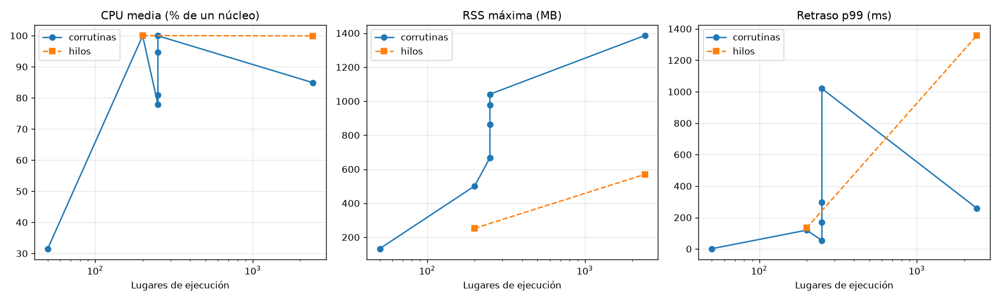
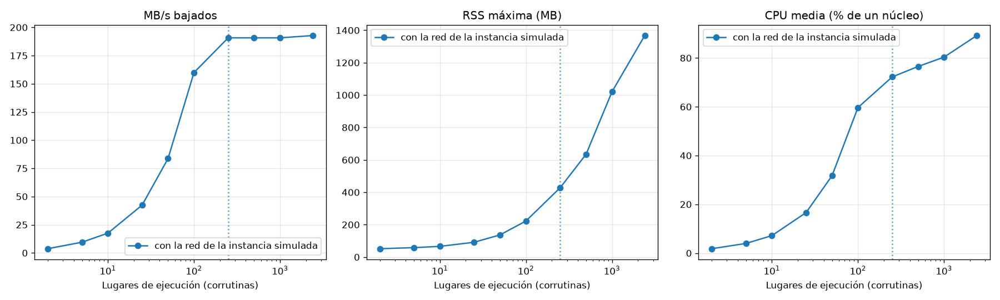
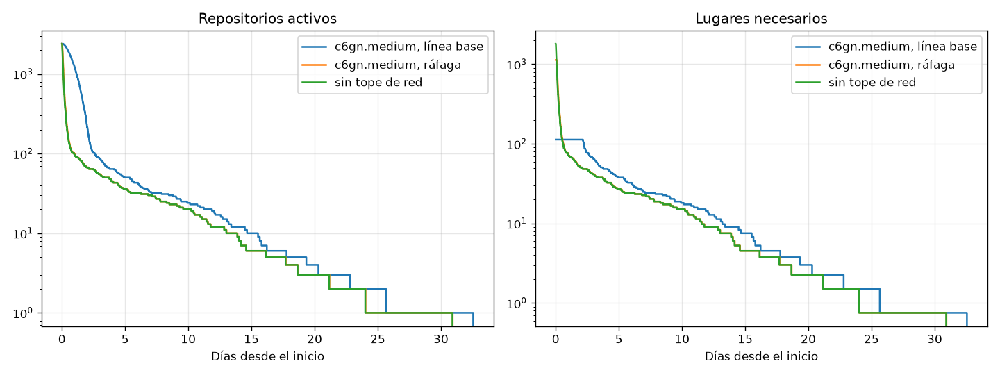

# Prueba de concurrencia: resultados

## Supuestos

- Velocidad por conexión: 2,1 MB/s. Es el supuesto que más mueve la duración: ver la tabla de sensibilidad en la proyección (y `relevamiento medir-velocidad` para medirla).
- Latencia hasta los encabezados: log-normal con p50 0.47 s y p95 1.9 s (pilotos).
- Archivos: log-normal con p50 0,53 MB y p95 38,0 MB, cortada en 200,6 MB: media 8,1 MB (pilotos, 51 archivos).
- Intervalo de cortesía: 1.0 s desde el fin de cada pedido.
- Versiones: python 3.12.3, aiohttp 3.14.5, plataforma Linux-7.0.0-1014-aws-aarch64-with-glibc2.39.

## Escenarios

Instancia simulada: **c6gn.medium** (1 vCPU, 2 GB, red base 190,7 MB/s). Valores sin el calentamiento; CPU en % de un núcleo.

| Esc. | Modo | Lugares | Repos | Tope de red (MB/s) | Pedidos/s | MB/s | CPU media | CPU máx | RSS máx (MB) | Bucle p99 (ms) | Despacho p99 (ms) | Lat. p50 (ms) | Lat. p95 (ms) | Errores | Violaciones | CPU servidor máx |
|---|---|---|---|---|---|---|---|---|---|---|---|---|---|---|---|---|
| 1 | corrutinas | 50 | 500 | sin tope | 16,5 | 84,0 | 31,5 | 35,8 | 132,4 | 1,55 | 66.536,27 | 500,8 | 1.887,4 | 0 | 0 | 13,0 |
| 2 | corrutinas | 200 | 2000 | sin tope | 70,4 | 315,2 | 99,9 | 101,3 | 501,3 | 119,51 | 68.794,75 | 572,6 | 1.934,9 | 0 | 0 | 38,0 |
| 4 | corrutinas | 2400 | 2400 | 190,7 | 138,7 | 191,7 | 84,9 | 100,5 | 1.385,9 | 259,20 | 821,84 | 892,5 | 2.406,6 | 0 | 0 | 40,0 |
| 6 | corrutinas | 2400 | 2400 | sin tope | 0,6 | 351,4 | 100,0 | 100,5 | 1.853,9 | 1.160,20 | 1.022,68 | 0,0 | 0,0 | 0 | 0 | 38,5 |
| 7 | hilos | 2400 | 2400 | 190,7 | 150,2 | 180,8 | 99,9 | 101,0 | 569,2 | 1.357,22 | 12.036,09 | 883,2 | 3.083,1 | 0 | 0 | 44,0 |
| 2h | hilos | 200 | 2000 | sin tope | 69,2 | 295,0 | 100,0 | 101,0 | 252,5 | 133,29 | 68.492,61 | 653,3 | 2.004,4 | 0 | 0 | 36,0 |
| m250 | multiproceso | 250 | 2400 | 190,7 | 52,1 | 190,7 | 1,9 | 3,9 | 47,8 | 2,09 | 69.883,76 | 513,8 | 1.901,2 | 0 | 0 | 33,0 |
| s250 | corrutinas | 250 | 2400 | 190,7 | 52,0 | 189,6 | 94,8 | 99,5 | 667,0 | 53,89 | 69.347,16 | 494,1 | 1.807,0 | 0 | 0 | 33,1 |
| ms500 | multiproceso | 500 | 2400 | sin tope | 149,1 | 679,8 | 3,9 | 6,7 | 48,0 | 34,90 | 38.593,65 | 936,5 | 2.318,3 | 0 | 0 | 77,7 |
| sc250 | corrutinas | 250 | 2400 | 190,7 | 25,1 | 143,1 | 77,9 | 100,9 | 978,8 | 169,81 | 64.522,26 | 749,6 | 1.745,2 | 0 | 0 | 41,0 |
| sh250 | corrutinas | 250 | 2400 | 190,7 | 40,7 | 160,4 | 99,9 | 100,5 | 862,3 | 1.020,06 | 67.330,10 | 1.667,1 | 3.305,5 | 0 | 0 | 25,0 |
| ss250 | corrutinas | 250 | 2400 | sin tope | 53,5 | 191,1 | 80,9 | 100,5 | 1.041,0 | 295,83 | 69.848,15 | 491,6 | 1.949,2 | 0 | 0 | 35,0 |

Más detalle por escenario:

| Esc. | CPU sistema | CPU ms/pedido | CPU ms/MB | Hilos máx | Descriptores máx | Conexiones máx | Listos sin atender | GC ms/s | Steal % | Deriva RSS (MB/h) | DB tx/s | Commit p95 (ms) |
|---|---|---|---|---|---|---|---|---|---|---|---|---|
| 1 | 3,9 | 19,13 | 3,75 | 1 | 221 | 214 | 432,1 | 0,75 | 0,00 | 1.478,5 | 0,0 | 0,00 |
| 2 | 11,8 | 14,19 | 3,17 | 1 | 935 | 844 | 1.724,3 | 6,30 | 0,00 | 11.452,5 | 0,0 | 0,00 |
| 4 | 7,0 | 6,12 | 4,43 | 1 | 2391 | 2383 | 0,1 | 54,58 | 0,00 | 5.343,5 | 0,0 | 0,00 |
| 6 | 9,9 | 1.630,23 | 2,85 | 1 | 2407 | 2400 | 0,2 | 81,89 | 0,00 | 16.726,6 | 0,0 | 0,00 |
| 7 | 27,0 | 6,65 | 5,53 | 2404 | 2405 | 2363 | 125,2 | 586,22 | 0,00 | 19.155,0 | 0,0 | 0,00 |
| 2h | 14,8 | 14,46 | 3,39 | 204 | 1861 | 1725 | 1.725,8 | 25,31 | 0,00 | 5.782,9 | 0,0 | 0,00 |
| m250 | 0,4 | 0,36 | 0,10 | 1 | 18 | 6 | 2.093,5 | 0,00 | 0,00 | -0,8 | 0,0 | 0,00 |
| s250 | 16,9 | 18,22 | 5,00 | 9 | 1089 | 832 | 2.093,2 | 5,76 | 0,00 | 5.824,1 | 0,0 | 0,00 |
| ms500 | 0,9 | 0,26 | 0,06 | 1 | 18 | 6 | 1.736,4 | 0,00 | 0,00 | 3,7 | 0,0 | 0,00 |
| sc250 | 11,9 | 31,02 | 5,44 | 9 | 879 | 705 | 2.244,6 | 9,16 | 0,00 | 6.873,7 | 0,0 | 0,00 |
| sh250 | 21,4 | 24,53 | 6,23 | 31 | 896 | 695 | 2.110,8 | 33,30 | 0,00 | 5.800,3 | 0,0 | 0,00 |
| ss250 | 10,4 | 15,12 | 4,23 | 9 | 1062 | 756 | 2.094,3 | 13,56 | 0,00 | 19.948,9 | 0,0 | 0,00 |

## Gráficos

## Barrido: cuántas tareas concurrentes convienen

El problema real (2.400 repositorios) con distintas cantidades de lugares de ejecución. La **rodilla** es la menor cantidad de lugares que llega al 95% del máximo: más lugares ya no bajan más rápido, solo esperan. Con pocos lugares, la ocupación alta y el despacho largo son lo esperado: hay más trabajo que lugares.

### Con la red de la instancia simulada

| Lugares | Ocupación % | Pedidos/s | Ítems/s | MB/s | CPU media | RSS máx (MB) | Bucle p99 (ms) | Despacho p99 (ms) | Errores | Violaciones |
|---|---|---|---|---|---|---|---|---|---|---|
| 2 | 100,0 | 0,4 | 0,24 | 3,7 | 1,8 | 51,6 | 2,03 | 36.780,1 | 0 | 0 |
| 5 | 100,0 | 1,1 | 0,38 | 9,5 | 4,0 | 58,2 | 1,91 | 38.297,6 | 0 | 0 |
| 10 | 100,0 | 3,3 | 1,34 | 17,5 | 7,2 | 66,1 | 2,09 | 34.935,1 | 0 | 0 |
| 25 | 100,0 | 8,1 | 2,61 | 42,4 | 16,6 | 91,4 | 1,23 | 36.097,7 | 0 | 0 |
| 50 | 100,0 | 16,4 | 5,19 | 83,7 | 31,7 | 136,9 | 1,31 | 37.771,2 | 0 | 0 |
| 100 | 100,0 | 38,2 | 11,81 | 159,9 | 59,7 | 222,8 | 2,09 | 38.654,2 | 0 | 0 |
| 250 | 100,0 | 58,8 | 22,35 | 190,7 | 72,2 | 428,3 | 6,41 | 38.975,5 | 0 | 0 |
| 500 | 100,0 | 76,1 | 27,10 | 190,7 | 76,5 | 634,9 | 52,04 | 39.201,4 | 0 | 0 |
| 1000 | 100,0 | 104,8 | 36,86 | 190,7 | 80,3 | 1.020,7 | 100,82 | 31.404,8 | 0 | 0 |
| 2400 | 91,2 | 179,7 | 53,76 | 192,8 | 89,2 | 1.367,4 | 352,06 | 966,7 | 0 | 0 |

- **Rodilla:** con 250 lugares se llega al 95% de los MB/s máximos (190,7 MB/s). Los ítems/s no sirven para esto en corridas cortas: con más lugares se terminan primero los ítems chicos aunque los MB/s sean los mismos; a la larga, ítems/s = MB/s / MB por ítem.
- **Costo de sobrar:** cada lugar de más después de la rodilla suma 447,3 KB de memoria y 0,008 puntos de CPU (2150 lugares de más).

## Un proceso contra un planificador y N workers

El modo multiproceso tiene un proceso planificador (aplica la cortesía y reparte) y N procesos workers con sus propias corrutinas, conectados por TCP (en la prueba por 127.0.0.1; los mismos workers podrían estar en otras máquinas). Se compara con un solo proceso en el mismo problema, con los mismos lugares y la misma red. **La CPU total es la del planificador más la de todos los workers**: lo que cuesta repartir el trabajo.

| Esc. | Arquitectura | Lugares | Tope de red | MB/s | CPU planificador | CPU workers (suma) | CPU total | CPU ms/MB | Memoria total (MB) | Bucle p99 planificador / workers (ms) | Despacho p99 (ms) | Errores | Violaciones |
|---|---|---|---|---|---|---|---|---|---|---|---|---|---|
| b250 | un proceso | 250 | 190,7 | 190,7 | 72,2 | — | 72,2 | 3,79 | 428 | 6,4 | 38.975,5 | 0 | 0 |
| m250 | planificador + 2 workers | 250 | 190,7 | 190,7 | 1,9 | 78,1 | 79,9 | 4,19 | 676 | 2,1 / 3,0 | 69.883,8 | 0 | 0 |
| bs500 | un proceso | 500 | sin tope | 350,7 | 100,0 | — | 100,0 | 2,85 | 1.114 | 482,0 | 56.853,2 | 0 | 0 |
| ms500 | planificador + 2 workers | 500 | sin tope | 679,8 | 3,9 | 195,9 | 199,8 | 2,94 | 1.802 | 34,9 / 263,0 | 38.593,7 | 0 | 0 |

- **Con la red de la instancia:** si un proceso ya llena la red, repartir no baja más rápido; muestra cuánto cuesta de más (CPU total y memoria) tener el trabajo en varios procesos.
- **Sin tope de red:** muestra si repartir en N procesos pasa el techo de un núcleo. Si los MB/s suben, el multiproceso escala; la pregunta es si hace falta, frente a lo que da la red de la instancia.
- La CPU ms/MB se calcula con la CPU total: es el costo de procesar cada MB en cada arquitectura.

## Subida a S3

El motor guarda cada archivo mientras lo baja (los de menos de 8 MB en el spool en RAM, los demás en disco) y, al terminar, lo deja para un proceso subidor aparte (boto3, en su propio núcleo) que lo sube a un S3 falso local. Si lo pendiente pasa 256 MB en RAM o 4.096 MB en disco, el motor deja de repartir tareas nuevas ("frenado"). **Lo que importa: frenado en 0 y lo pendiente estable** quieren decir que la descarga nunca esperó a la subida.

| Esc. | Dónde sube | Lugares | Tope de red | MB/s bajados | MB/s subidos | CPU motor | CPU motor sin subida | RSS motor (MB) | CPU subidor (media / máx) | Pendiente máx RAM / disco (MB) | Frenado (s) | Escritura a disco (MB/s) | Objetos (multipart) | Errores de subida | Pendiente al final (MB) |
|---|---|---|---|---|---|---|---|---|---|---|---|---|---|---|---|
| s250 | proceso aparte (16) | 250 | 190,7 | 189,6 | 115,3 | 94,8 | 72,2 (b250) | 667 | 41,3 / 76,5 | 102 / 205 | 0,0 | 125,8 | 2829 (260) | 0 | 0 |
| sc250 | corrutinas en el motor (16) | 250 | 190,7 | 143,1 | 44,0 | 77,9 | 72,2 (b250) | 979 | en la del motor | 354 / 3.422 | 40,2 | 122,0 | 1445 (98) | 0 | 3.630 |
| sh250 | hilos en el motor (16) | 250 | 190,7 | 160,4 | 97,7 | 99,9 | 72,2 (b250) | 862 | en la del motor | 47 / 155 | 0,0 | 120,5 | 2287 (220) | 0 | 0 |
| ss250 | proceso aparte (16) | 250 | sin tope | 191,1 | 113,3 | 80,9 | — | 1.041 | 42,5 / 78,4 | 40 / 172 | 0,0 | 123,4 | 2788 (260) | 0 | 0 |

- **Dónde sube:** proceso aparte (en su propio núcleo), un pool de hilos con s3transfer dentro del proceso del motor, o un pool de corrutinas con aiobotocore dentro del bucle del motor. Entre paréntesis, las subidas a la vez. El spool es el mismo en los tres: la única diferencia es dónde corre la subida.
- **CPU motor contra la referencia sin subida:** en proceso aparte, lo que le agrega al motor escribir el spool; con hilos o corrutinas, además todo el costo de subir, que comparte el núcleo (y el GIL) con la descarga. Si la CPU llega al 100 %, bajan los MB/s bajados y sube el retraso del bucle.
- **CPU del subidor:** solo se ve aparte en el proceso aparte. Con el SDK CRT de AWS sería menos.
- **Escritura a disco:** de toda la máquina; es lo que tiene que sostener el volumen EBS del spool (gp3 da 125 MB/s de base) y el tope de EBS de la instancia.
- En corridas cortas pasan sobre todo los archivos chicos: los grandes no llegan a terminar de bajar, así que el spool en disco aparece menos de lo que se usaría en la descarga real.

## Proyección al problema real

2400 repositorios y 6 M de ítems repartidos con la regla del simulador del descargador: el repositorio más grande tiene 219,286 ítems, la mediana es 596 y el 4 % más grande concentra el 66,6 %.

Modelo calibrado (cuentas):

- Resolución: latencia media 0,67 s. Descarga: latencia + archivo medio / ancho = 4,25 s. Medido en el escenario de referencia: resolución 1,41 s y descarga 10,51 s.
- Un ítem son 1 resolución y 2,0 descargas: con 1.0 s de cortesía después de cada pedido, ocupa al repositorio 12,2 s y baja 16,2 MB.
- Total a bajar: 97,4 TB.
- **Pico** (todos los repositorios activos): 591 pedidos/s, 3.050 MB/s de demanda y unos 1.809 pedidos en curso.
- **Cota por cortesía:** el repositorio más grande tarda 219,286 × 12,2 s = **30,9 días**, haya una máquina o cien.
- **Cota por red (c6gn.medium, línea base, 190,7 MB/s):** 97,4 TB / red = **5,6 días**. CPU que pide procesar esa red a 2,85 ms de CPU por MB: 0,54 núcleos.
- **Cota por red (c6gn.medium, ráfaga, 1.907,3 MB/s):** 97,4 TB / red = **0,6 días**. CPU que pide procesar esa red a 2,85 ms de CPU por MB: 5,43 núcleos.
- **Capacidad medida de un proceso con corrutinas:** 351,4 MB/s en el escenario 6.

Distribuir solo ayuda si un proceso no llega a procesar lo que da la red de la instancia; si llega, el límite es la red, y se resuelve con una instancia de más red.

### A lo largo de toda la descarga

Modelo de fluido con la distribución de ítems: mientras hay repositorios activos, todos avanzan al ritmo de la cortesía o, si la red no alcanza, a la parte de la red que les toca; los chicos terminan primero. Lugares necesarios: los que pide la cortesía (cada repositorio está ocupado 9,18 s de cada 12,18 s) o los que llenan la red, lo que sea menor.

| Red | Duración (días) | Lugares que llenan la red | Día 0: activos / lugares / MB/s | Día 1: activos / lugares / MB/s | Día 7: activos / lugares / MB/s | Día 14: activos / lugares / MB/s | Día 30: activos / lugares / MB/s | Día 60: activos / lugares / MB/s |
|---|---|---|---|---|---|---|---|---|
| c6gn.medium, línea base | 32,6 | 113 | 2400 / 113 / 190,7 | 1217 / 113 / 190,7 | 33 / 25 / 41,9 | 12 / 9 / 15,2 | 1 / 1 / 1,3 | terminó |
| c6gn.medium, ráfaga | 30,9 | 1.131 | 2400 / 1.131 / 1.907,3 | 98 / 74 / 124,5 | 30 / 23 / 38,1 | 9 / 7 / 11,4 | 1 / 1 / 1,3 | terminó |
| sin tope de red | 30,9 | — | 2400 / 1.809 / 3.050,0 | 97 / 73 / 123,3 | 30 / 23 / 38,1 | 9 / 7 / 11,4 | 1 / 1 / 1,3 | terminó |

### Sensibilidad a la velocidad por conexión

Como cada repositorio recibe un pedido a la vez, si sus archivos llegan más lento avanza más lento, y el repositorio más grande tarda más: ninguna máquina ni más red compensa eso. Con la red de la c6gn.medium:

| MB/s por conexión | Tiempo por ítem (s) | Repositorio más grande (días) | Duración total (días) | Corrutinas que llenan la red |
|---|---|---|---|---|
| 0,5 | 35,8 | 90,9 | 91,9 | 404 |
| 1,0 | 20,4 | 51,8 | 53,2 | 215 |
| 2,0 | 12,7 | 32,3 | 33,9 | 120 |
| 2,1 ← esta corrida | 12,2 | 30,9 | 32,6 | 113 |
| 5,0 | 8,1 | 20,6 | 22,4 | 63 |

### Instancias candidatas

Para cada instancia, con su red base: duración del modelo, corrutinas que llenan la red, MB/s al principio, CPU que pide procesarlos (2,85 ms de CPU por MB, medidos en el escenario 6 en la máquina de esta corrida: vale para ese mismo tipo de procesador), memoria según el barrido y costo on-demand en us-east-1 por toda la descarga. Precios y redes de config.INSTANCIAS: verificar antes de decidir.

| Instancia | vCPU / RAM | Red base (MB/s) | $/h | Duración (días) | Corrutinas | MB/s | CPU (% de un núcleo) | Memoria (MB) | Costo total |
|---|---|---|---|---|---|---|---|---|---|
| t3.small | 2 / 2 GB | 15,3 | 0,0208 | 83,8 | 9 | 15,3 | 4,3 | 65 | $42 |
| t3.medium | 2 / 4 GB | 30,5 | 0,0416 | 52,2 | 18 | 30,5 | 8,7 | 80 | $52 |
| t3.large | 2 / 8 GB | 61,0 | 0,0832 | 38,8 | 36 | 61,0 | 17,4 | 112 | $77 |
| t3.xlarge | 4 / 16 GB | 122,1 | 0,1664 | 33,9 | 72 | 122,1 | 34,7 | 175 | $135 |
| c7g.medium | 1 / 2 GB | 62,0 | 0,0363 | 38,6 | 37 | 62,0 | 17,6 | 113 | $34 |
| c7g.large | 2 / 4 GB | 111,7 | 0,0725 | 34,2 | 66 | 111,7 | 31,8 | 165 | $60 |
| c6i.large | 2 / 4 GB | 93,1 | 0,0850 | 35,2 | 55 | 93,1 | 26,5 | 146 | $72 |
| c6gn.medium ← | 1 / 2 GB | 190,7 | 0,0432 | 32,6 | 113 | 190,7 | 54,3 | 241 | $34 |
| c6gn.large | 2 / 4 GB | 357,6 | 0,0864 | 31,6 | 212 | 357,6 | 101,8 ⚠ | 376 | $66 |
| c7gn.medium | 1 / 2 GB | 372,5 | 0,0624 | 31,6 | 221 | 372,5 | 106,0 ⚠ | 388 | $47 |

⚠: la CPU que pide pasa lo que la instancia sostiene (línea base de créditos en las t3; 80 % de un núcleo en las demás, porque un proceso de Python usa uno solo).

## Criterio de decisión

| Escenario | Condición | Resultado |
|---|---|---|
| 4 | Cero violaciones de cortesía y cero errores | cumple |
| 4 | Retraso de despacho p99 < 100 ms | **no cumple** |
| 4 | Retraso del bucle p99 < 50 ms | **no cumple** |
| 4 | CPU media < 80 % de un núcleo (un proceso usa uno; margen para Postgres) | **no cumple** |
| 4 | RSS máxima < 1024 MB | **no cumple** |
| 4 | El servidor simulado no fue el límite | cumple |
| 9 | Cero violaciones de cortesía y cero errores | sin datos |
| 9 | Retraso de despacho p99 < 100 ms | sin datos |
| 9 | Retraso del bucle p99 < 50 ms | sin datos |
| 9 | CPU media < 80 % de un núcleo (un proceso usa uno; margen para Postgres) | sin datos |
| 9 | RSS máxima < 1024 MB | sin datos |
| 9 | El servidor simulado no fue el límite | sin datos |
| 9 | Memoria estable: deriva < 10% de la RSS media por hora | sin datos |

## Conclusión

_Completar a mano con los números de arriba: si alcanza un proceso con corrutinas, en qué instancia, qué recurso se agota primero y cómo se comparan las corrutinas con los hilos._
