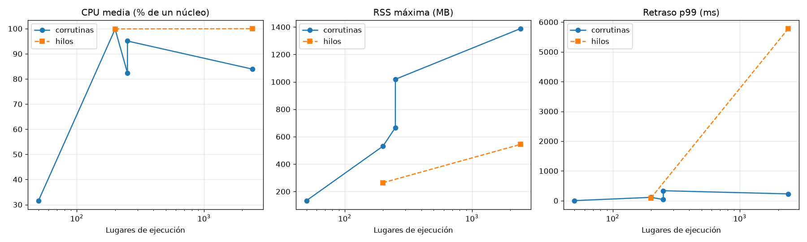
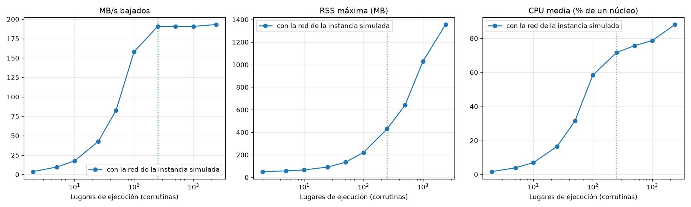
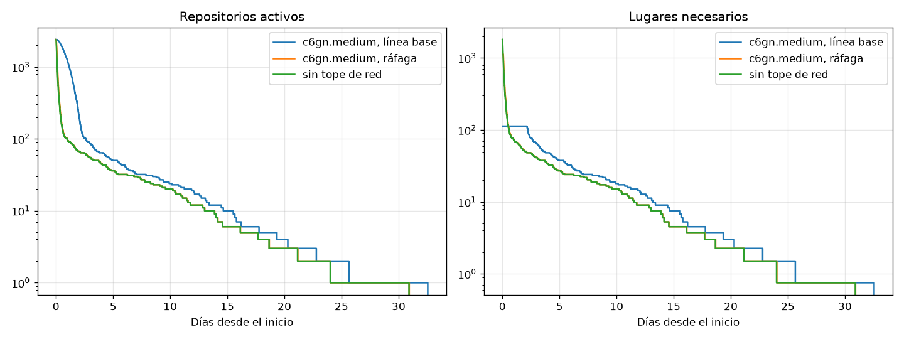

# Prueba de concurrencia: resultados

## Instancia

- **tipo:** c6gn.xlarge
- **vcpu:** 4
- **memoria_mb:** 7756
- **sistema:** Linux-7.0.0-1014-aws-aarch64-with-glibc2.39
- **python:** 3.12.3
- **aiohttp:** 3.14.5

## Supuestos

- Velocidad por conexión: 2,1 MB/s. Es el supuesto que más mueve la duración: ver la tabla de sensibilidad en la proyección (y `relevamiento medir-velocidad` para medirla).
- Latencia hasta los encabezados: log-normal con p50 0.47 s y p95 1.9 s (pilotos).
- Archivos: log-normal con p50 0,53 MB y p95 38,0 MB, cortada en 200,6 MB: media 8,1 MB (pilotos, 51 archivos).
- Intervalo de cortesía: 1.0 s desde el fin de cada pedido.
- Versiones: python 3.12.3, aiohttp 3.14.5, plataforma Linux-7.0.0-1014-aws-aarch64-with-glibc2.39.

## Escenarios

Instancia simulada: **c6gn.medium** (1 vCPU, 2 GB, red base 190,7 MB/s). Valores sin el calentamiento; CPU en % de un núcleo.

| Esc. | Modo | Lugares | Repos | Tope de red (MB/s) | Pedidos/s | MB/s | CPU media | CPU máx | RSS máx (MB) | Bucle p99 (ms) | Despacho p99 (ms) | Lat. p50 (ms) | Lat. p95 (ms) | Errores | Violaciones | CPU servidor máx |
|---|---|---|---|---|---|---|---|---|---|---|---|---|---|---|---|---|
| 1 | corrutinas | 50 | 500 | sin tope | 16,4 | 84,4 | 31,6 | 36,0 | 133,6 | 1,43 | 68.876,36 | 504,7 | 1.826,6 | 0 | 0 | 12,0 |
| 2 | corrutinas | 200 | 2000 | sin tope | 71,7 | 318,4 | 99,8 | 101,4 | 531,2 | 111,52 | 68.745,89 | 531,5 | 1.952,8 | 0 | 0 | 39,9 |
| 4 | corrutinas | 2400 | 2400 | 190,7 | 139,7 | 191,4 | 83,9 | 100,4 | 1.387,9 | 227,73 | 923,15 | 892,1 | 2.521,1 | 0 | 0 | 42,0 |
| 6 | corrutinas | 2400 | 2400 | sin tope | 0,5 | 348,3 | 100,0 | 100,6 | 1.906,3 | 1.170,87 | 1.206,94 | 0,0 | 0,0 | 0 | 0 | 32,5 |
| 7 | hilos | 2400 | 2400 | 190,7 | 143,0 | 167,4 | 100,0 | 100,6 | 543,6 | 5.777,94 | 24.796,18 | 1.022,0 | 3.514,8 | 0 | 0 | 40,0 |
| 2h | hilos | 200 | 2000 | sin tope | 71,9 | 307,1 | 99,9 | 102,6 | 264,3 | 89,43 | 68.876,19 | 604,1 | 2.005,1 | 0 | 0 | 38,0 |
| s250 | corrutinas | 250 | 2400 | 190,7 | 51,9 | 189,7 | 95,1 | 100,7 | 666,7 | 39,40 | 69.313,59 | 496,1 | 1.893,3 | 0 | 0 | 31,0 |
| ss250 | corrutinas | 250 | 2400 | sin tope | 53,9 | 197,6 | 82,4 | 100,5 | 1.019,0 | 334,17 | 67.153,80 | 511,4 | 2.048,3 | 0 | 0 | 32,9 |

Más detalle por escenario:

| Esc. | CPU sistema | CPU ms/pedido | CPU ms/MB | Hilos máx | Descriptores máx | Conexiones máx | Listos sin atender | GC ms/s | Steal % | Deriva RSS (MB/h) | DB tx/s | Commit p95 (ms) |
|---|---|---|---|---|---|---|---|---|---|---|---|---|
| 1 | 3,9 | 19,22 | 3,74 | 1 | 223 | 216 | 432,2 | 0,77 | 0,00 | 1.630,4 | 0,0 | 0,00 |
| 2 | 11,6 | 13,92 | 3,13 | 1 | 946 | 852 | 1.720,7 | 5,94 | 0,00 | 14.370,9 | 0,0 | 0,00 |
| 4 | 7,0 | 6,01 | 4,38 | 1 | 2393 | 2383 | 0,2 | 51,07 | 0,00 | 6.517,8 | 0,0 | 0,00 |
| 6 | 9,9 | 2.060,58 | 2,87 | 1 | 2407 | 2400 | 0,8 | 81,30 | 0,00 | 16.349,8 | 0,0 | 0,00 |
| 7 | 31,3 | 6,99 | 5,97 | 2404 | 2404 | 2353 | 40,9 | 825,60 | 0,00 | 10.167,3 | 0,0 | 0,00 |
| 2h | 16,6 | 13,89 | 3,25 | 204 | 1953 | 1780 | 1.723,1 | 25,21 | 0,00 | 5.499,4 | 0,0 | 0,00 |
| s250 | 16,9 | 18,32 | 5,01 | 9 | 1075 | 821 | 2.094,5 | 5,23 | 0,00 | 6.790,7 | 0,0 | 0,00 |
| ss250 | 11,6 | 15,29 | 4,17 | 9 | 1037 | 741 | 2.092,3 | 15,22 | 0,00 | 22.677,8 | 0,0 | 0,00 |

## Gráficos

## Barrido: cuántas tareas concurrentes convienen

El problema real (2.400 repositorios) con distintas cantidades de lugares de ejecución. La **rodilla** es la menor cantidad de lugares que llega al 95% del máximo: más lugares ya no bajan más rápido, solo esperan. Con pocos lugares, la ocupación alta y el despacho largo son lo esperado: hay más trabajo que lugares.

### Con la red de la instancia simulada

| Lugares | Ocupación % | Pedidos/s | Ítems/s | MB/s | CPU media | RSS máx (MB) | Bucle p99 (ms) | Despacho p99 (ms) | Errores | Violaciones |
|---|---|---|---|---|---|---|---|---|---|---|
| 2 | 100,0 | 0,4 | 0,24 | 3,7 | 1,8 | 51,4 | 1,96 | 36.778,7 | 0 | 0 |
| 5 | 100,0 | 1,1 | 0,38 | 9,6 | 4,0 | 57,8 | 1,68 | 30.092,3 | 0 | 0 |
| 10 | 100,0 | 3,3 | 1,34 | 17,5 | 7,0 | 65,6 | 2,01 | 34.933,4 | 0 | 0 |
| 25 | 100,0 | 8,4 | 2,79 | 42,5 | 16,5 | 92,0 | 1,22 | 38.687,9 | 0 | 0 |
| 50 | 100,0 | 17,2 | 5,47 | 82,7 | 31,5 | 134,5 | 1,25 | 38.837,2 | 0 | 0 |
| 100 | 100,0 | 37,1 | 11,82 | 158,0 | 58,4 | 221,0 | 1,78 | 38.706,8 | 0 | 0 |
| 250 | 100,0 | 59,0 | 21,93 | 190,7 | 71,6 | 430,1 | 6,92 | 39.132,9 | 0 | 0 |
| 500 | 100,0 | 75,6 | 27,77 | 190,7 | 75,7 | 640,2 | 45,56 | 39.099,3 | 0 | 0 |
| 1000 | 100,0 | 102,7 | 36,42 | 190,7 | 78,7 | 1.028,6 | 106,85 | 31.408,2 | 0 | 0 |
| 2400 | 91,3 | 180,3 | 54,58 | 193,1 | 88,1 | 1.355,8 | 216,10 | 807,1 | 0 | 0 |

- **Rodilla:** con 250 lugares se llega al 95% de los MB/s máximos (190,7 MB/s). Los ítems/s no sirven para esto en corridas cortas: con más lugares se terminan primero los ítems chicos aunque los MB/s sean los mismos; a la larga, ítems/s = MB/s / MB por ítem.
- **Costo de sobrar:** cada lugar de más después de la rodilla suma 440,9 KB de memoria y 0,008 puntos de CPU (2150 lugares de más).

## Subida a S3

El motor guarda cada archivo mientras lo baja (los de menos de 8 MB en el spool en RAM, los demás en disco) y, al terminar, lo deja para un proceso subidor aparte (boto3, en su propio núcleo) que lo sube a un S3 falso local. Si lo pendiente pasa 256 MB en RAM o 4.096 MB en disco, el motor deja de repartir tareas nuevas ("frenado"). **Lo que importa: frenado en 0 y lo pendiente estable** quieren decir que la descarga nunca esperó a la subida.

| Esc. | Lugares | Tope de red | MB/s bajados | MB/s subidos | CPU motor | CPU motor sin subida | RSS motor (MB) | CPU subidor (media / máx) | Pendiente máx RAM / disco (MB) | Frenado (s) | Escritura a disco (MB/s) | Objetos (multipart) | Errores de subida | Pendiente al final (MB) |
|---|---|---|---|---|---|---|---|---|---|---|---|---|---|---|
| s250 | 250 | 190,7 | 189,7 | 114,3 | 95,1 | 71,6 (b250) | 667 | 41,7 / 86,0 | 49 / 198 | 0,0 | 125,0 | 2817 (261) | 0 | 0 |
| ss250 | 250 | sin tope | 197,6 | 120,5 | 82,4 | — | 1.019 | 43,9 / 81,0 | 47 / 116 | 0,0 | 122,2 | 2808 (261) | 0 | 0 |

- **CPU motor contra la referencia sin subida:** lo que le agrega al motor escribir el spool (la escritura va en hilos aparte, pero dentro del mismo proceso).
- **CPU del subidor:** lo que cuesta subir, en un proceso aparte. Con el SDK CRT de AWS sería menos.
- **Escritura a disco:** de toda la máquina; es lo que tiene que sostener el volumen EBS del spool (gp3 da 125 MB/s de base) y el tope de EBS de la instancia.
- En corridas cortas pasan sobre todo los archivos chicos: los grandes no llegan a terminar de bajar, así que el spool en disco aparece menos de lo que se usaría en la descarga real.

## Proyección al problema real

2400 repositorios y 6 M de ítems repartidos con la regla del simulador del descargador: el repositorio más grande tiene 219,286 ítems, la mediana es 596 y el 4 % más grande concentra el 66,6 %.

Modelo calibrado (cuentas):

- Resolución: latencia media 0,67 s. Descarga: latencia + archivo medio / ancho = 4,25 s. Medido en el escenario de referencia: resolución 1,40 s y descarga 10,54 s.
- Un ítem son 1 resolución y 2,0 descargas: con 1.0 s de cortesía después de cada pedido, ocupa al repositorio 12,2 s y baja 16,2 MB.
- Total a bajar: 97,4 TB.
- **Pico** (todos los repositorios activos): 591 pedidos/s, 3.050 MB/s de demanda y unos 1.809 pedidos en curso.
- **Cota por cortesía:** el repositorio más grande tarda 219,286 × 12,2 s = **30,9 días**, haya una máquina o cien.
- **Cota por red (c6gn.medium, línea base, 190,7 MB/s):** 97,4 TB / red = **5,6 días**. CPU que pide procesar esa red a 2,87 ms de CPU por MB: 0,55 núcleos.
- **Cota por red (c6gn.medium, ráfaga, 1.907,3 MB/s):** 97,4 TB / red = **0,6 días**. CPU que pide procesar esa red a 2,87 ms de CPU por MB: 5,48 núcleos.
- **Capacidad medida de un proceso con corrutinas:** 348,3 MB/s en el escenario 6.

Distribuir solo ayuda si un proceso no llega a procesar lo que da la red de la instancia; si llega, el límite es la red, y se resuelve con una instancia de más red.

### A lo largo de toda la descarga

Modelo de fluido con la distribución de ítems: mientras hay repositorios activos, todos avanzan al ritmo de la cortesía o, si la red no alcanza, a la parte de la red que les toca; los chicos terminan primero. Lugares necesarios: los que pide la cortesía (cada repositorio está ocupado 9,18 s de cada 12,18 s) o los que llenan la red, lo que sea menor.

| Red | Duración (días) | Lugares que llenan la red | Día 0: activos / lugares / MB/s | Día 1: activos / lugares / MB/s | Día 7: activos / lugares / MB/s | Día 14: activos / lugares / MB/s | Día 30: activos / lugares / MB/s | Día 60: activos / lugares / MB/s |
|---|---|---|---|---|---|---|---|---|
| c6gn.medium, línea base | 32,6 | 113 | 2400 / 113 / 190,7 | 1217 / 113 / 190,7 | 33 / 25 / 41,9 | 12 / 9 / 15,2 | 1 / 1 / 1,3 | terminó |
| c6gn.medium, ráfaga | 30,9 | 1.131 | 2400 / 1.131 / 1.907,3 | 98 / 74 / 124,5 | 30 / 23 / 38,1 | 9 / 7 / 11,4 | 1 / 1 / 1,3 | terminó |
| sin tope de red | 30,9 | — | 2400 / 1.809 / 3.050,0 | 97 / 73 / 123,3 | 30 / 23 / 38,1 | 9 / 7 / 11,4 | 1 / 1 / 1,3 | terminó |

### Sensibilidad a la velocidad por conexión

Como cada repositorio recibe un pedido a la vez, si sus archivos llegan más lento avanza más lento, y el repositorio más grande tarda más: ninguna máquina ni más red compensa eso. Con la red de la c6gn.medium:

| MB/s por conexión | Tiempo por ítem (s) | Repositorio más grande (días) | Duración total (días) | Corrutinas que llenan la red |
|---|---|---|---|---|
| 0,5 | 35,8 | 90,9 | 91,9 | 404 |
| 1,0 | 20,4 | 51,8 | 53,2 | 215 |
| 2,0 | 12,7 | 32,3 | 33,9 | 120 |
| 2,1 ← esta corrida | 12,2 | 30,9 | 32,6 | 113 |
| 5,0 | 8,1 | 20,6 | 22,4 | 63 |

### Instancias candidatas

Para cada instancia, con su red base: duración del modelo, corrutinas que llenan la red, MB/s al principio, CPU que pide procesarlos (2,87 ms de CPU por MB, medidos en el escenario 6 en la máquina de esta corrida: vale para ese mismo tipo de procesador), memoria según el barrido y costo on-demand en us-east-1 por toda la descarga. Precios y redes de config.INSTANCIAS: verificar antes de decidir.

| Instancia | vCPU / RAM | Red base (MB/s) | $/h | Duración (días) | Corrutinas | MB/s | CPU (% de un núcleo) | Memoria (MB) | Costo total |
|---|---|---|---|---|---|---|---|---|---|
| t3.small | 2 / 2 GB | 15,3 | 0,0208 | 83,8 | 9 | 15,3 | 4,4 | 64 | $42 |
| t3.medium | 2 / 4 GB | 30,5 | 0,0416 | 52,2 | 18 | 30,5 | 8,8 | 80 | $52 |
| t3.large | 2 / 8 GB | 61,0 | 0,0832 | 38,8 | 36 | 61,0 | 17,5 | 111 | $77 |
| t3.xlarge | 4 / 16 GB | 122,1 | 0,1664 | 33,9 | 72 | 122,1 | 35,1 | 173 | $135 |
| c7g.medium | 1 / 2 GB | 62,0 | 0,0363 | 38,6 | 37 | 62,0 | 17,8 | 112 | $34 |
| c7g.large | 2 / 4 GB | 111,7 | 0,0725 | 34,2 | 66 | 111,7 | 32,1 | 163 | $60 |
| c6i.large | 2 / 4 GB | 93,1 | 0,0850 | 35,2 | 55 | 93,1 | 26,7 | 144 | $72 |
| c6gn.medium ← | 1 / 2 GB | 190,7 | 0,0432 | 32,6 | 113 | 190,7 | 54,8 | 239 | $34 |
| c6gn.large | 2 / 4 GB | 357,6 | 0,0864 | 31,6 | 212 | 357,6 | 102,7 ⚠ | 377 | $66 |
| c7gn.medium | 1 / 2 GB | 372,5 | 0,0624 | 31,6 | 221 | 372,5 | 107,0 ⚠ | 390 | $47 |

⚠: la CPU que pide pasa lo que la instancia sostiene (línea base de créditos en las t3; 80 % de un núcleo en las demás, porque un proceso de Python usa uno solo).

## Criterio de decisión

| Escenario | Condición | Resultado |
|---|---|---|
| 4 | Cero violaciones de cortesía y cero errores | cumple |
| 4 | Retraso de despacho p99 < 100 ms | **no cumple** |
| 4 | Retraso del bucle p99 < 50 ms | **no cumple** |
| 4 | CPU media < 80 % de un núcleo (un proceso usa uno; margen para Postgres) | **no cumple** |
| 4 | RSS máxima < 1024 MB | **no cumple** |
| 4 | El servidor simulado no fue el límite | cumple |
| 9 | Cero violaciones de cortesía y cero errores | sin datos |
| 9 | Retraso de despacho p99 < 100 ms | sin datos |
| 9 | Retraso del bucle p99 < 50 ms | sin datos |
| 9 | CPU media < 80 % de un núcleo (un proceso usa uno; margen para Postgres) | sin datos |
| 9 | RSS máxima < 1024 MB | sin datos |
| 9 | El servidor simulado no fue el límite | sin datos |
| 9 | Memoria estable: deriva < 10% de la RSS media por hora | sin datos |

## Conclusión

_Completar a mano con los números de arriba: si alcanza un proceso con corrutinas, en qué instancia, qué recurso se agota primero y cómo se comparan las corrutinas con los hilos._
