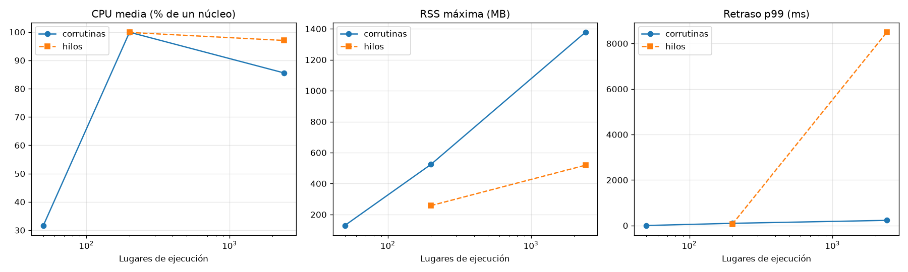
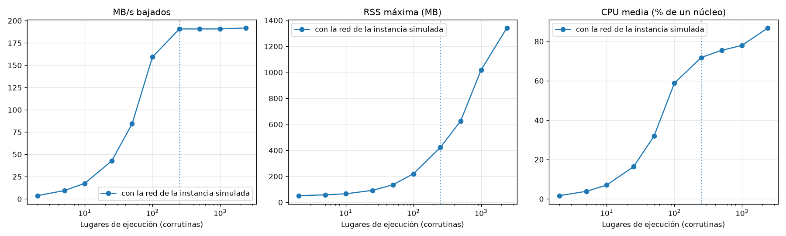
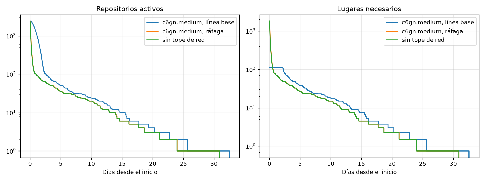

# Prueba de concurrencia: resultados

## Instancia

- **tipo:** c6gn.xlarge
- **vcpu:** 4
- **memoria_mb:** 7756
- **sistema:** Linux-7.0.0-1014-aws-aarch64-with-glibc2.39
- **python:** 3.12.3
- **aiohttp:** 3.14.5

## Supuestos

- Velocidad por conexión: 2,1 MB/s. Es el supuesto que más mueve la duración: ver la tabla de sensibilidad en la proyección (y `relevamiento medir-velocidad` para medirla).
- Latencia hasta los encabezados: log-normal con p50 0.47 s y p95 1.9 s (pilotos).
- Archivos: log-normal con p50 0,53 MB y p95 38,0 MB, cortada en 200,6 MB: media 8,1 MB (pilotos, 51 archivos).
- Intervalo de cortesía: 1.0 s desde el fin de cada pedido.
- Versiones: python 3.12.3, aiohttp 3.14.5, plataforma Linux-7.0.0-1014-aws-aarch64-with-glibc2.39.

## Escenarios

Instancia simulada: **c6gn.medium** (1 vCPU, 2 GB, red base 190,7 MB/s). Valores sin el calentamiento; CPU en % de un núcleo.

| Esc. | Modo | Lugares | Repos | Tope de red (MB/s) | Pedidos/s | MB/s | CPU media | CPU máx | RSS máx (MB) | Bucle p99 (ms) | Despacho p99 (ms) | Lat. p50 (ms) | Lat. p95 (ms) | Errores | Violaciones | CPU servidor máx |
|---|---|---|---|---|---|---|---|---|---|---|---|---|---|---|---|---|
| 1 | corrutinas | 50 | 500 | sin tope | 16,5 | 84,4 | 31,7 | 35,8 | 129,1 | 1,96 | 68.452,60 | 487,3 | 2.041,8 | 0 | 0 | 14,0 |
| 2 | corrutinas | 200 | 2000 | sin tope | 71,0 | 317,2 | 99,9 | 101,1 | 524,0 | 98,14 | 68.991,63 | 542,7 | 1.960,8 | 0 | 0 | 40,0 |
| 4 | corrutinas | 2400 | 2400 | 190,7 | 139,2 | 191,4 | 85,6 | 100,1 | 1.378,1 | 227,55 | 912,98 | 931,1 | 2.642,2 | 0 | 0 | 41,0 |
| 6 | corrutinas | 2400 | 2400 | sin tope | 0,6 | 347,2 | 100,0 | 100,6 | 1.944,8 | 1.290,57 | 1.246,57 | 0,0 | 0,0 | 0 | 0 | 41,0 |
| 7 | hilos | 2400 | 2400 | 190,7 | 136,0 | 195,2 | 97,0 | 119,8 | 518,7 | 8.495,59 | 21.642,96 | 1.081,5 | 3.115,5 | 0 | 0 | 45,9 |
| 2h | hilos | 200 | 2000 | sin tope | 72,4 | 309,8 | 99,9 | 103,3 | 257,8 | 65,18 | 68.526,27 | 578,8 | 1.942,3 | 0 | 0 | 38,0 |

Más detalle por escenario:

| Esc. | CPU sistema | CPU ms/pedido | CPU ms/MB | Hilos máx | Descriptores máx | Conexiones máx | Listos sin atender | GC ms/s | Steal % | Deriva RSS (MB/h) | DB tx/s | Commit p95 (ms) |
|---|---|---|---|---|---|---|---|---|---|---|---|---|
| 1 | 3,8 | 19,20 | 3,75 | 1 | 216 | 200 | 432,4 | 0,79 | 0,00 | 1.310,4 | 0,0 | 0,00 |
| 2 | 11,2 | 14,08 | 3,15 | 1 | 942 | 848 | 1.723,5 | 6,16 | 0,00 | 13.871,9 | 0,0 | 0,00 |
| 4 | 7,3 | 6,15 | 4,47 | 1 | 2396 | 2380 | 1,1 | 55,21 | 0,00 | 5.599,2 | 0,0 | 0,00 |
| 6 | 9,8 | 1.787,50 | 2,88 | 1 | 2407 | 2400 | 0,3 | 78,86 | 0,00 | 19.878,9 | 0,0 | 0,00 |
| 7 | 22,4 | 7,13 | 4,97 | 2404 | 2403 | 2350 | 332,6 | 1.387,08 | 0,00 | 11.194,4 | 0,0 | 0,00 |
| 2h | 17,2 | 13,79 | 3,22 | 204 | 1925 | 1800 | 1.721,3 | 36,35 | 0,00 | 5.420,4 | 0,0 | 0,00 |

## Gráficos

## Barrido: cuántas tareas concurrentes convienen

El problema real (2.400 repositorios) con distintas cantidades de lugares de ejecución. La **rodilla** es la menor cantidad de lugares que llega al 95% del máximo: más lugares ya no bajan más rápido, solo esperan. Con pocos lugares, la ocupación alta y el despacho largo son lo esperado: hay más trabajo que lugares.

### Con la red de la instancia simulada

| Lugares | Ocupación % | Pedidos/s | Ítems/s | MB/s | CPU media | RSS máx (MB) | Bucle p99 (ms) | Despacho p99 (ms) | Errores | Violaciones |
|---|---|---|---|---|---|---|---|---|---|---|
| 2 | 100,0 | 0,4 | 0,24 | 3,7 | 1,7 | 51,5 | 1,96 | 36.778,5 | 0 | 0 |
| 5 | 100,0 | 1,1 | 0,38 | 9,5 | 3,9 | 57,7 | 1,92 | 38.298,7 | 0 | 0 |
| 10 | 100,0 | 3,3 | 1,34 | 17,5 | 7,0 | 65,8 | 1,93 | 34.932,4 | 0 | 0 |
| 25 | 100,0 | 7,8 | 2,51 | 42,8 | 16,4 | 92,3 | 1,32 | 37.549,8 | 0 | 0 |
| 50 | 100,0 | 17,5 | 5,47 | 84,3 | 31,9 | 135,4 | 1,20 | 36.505,6 | 0 | 0 |
| 100 | 100,0 | 36,8 | 11,34 | 159,3 | 58,8 | 219,9 | 2,12 | 38.736,2 | 0 | 0 |
| 250 | 100,0 | 60,8 | 21,91 | 190,7 | 71,9 | 422,0 | 6,82 | 38.213,0 | 0 | 0 |
| 500 | 100,0 | 75,9 | 26,87 | 190,7 | 75,5 | 626,2 | 27,48 | 39.036,4 | 0 | 0 |
| 1000 | 100,0 | 102,8 | 36,71 | 190,7 | 78,0 | 1.017,4 | 132,53 | 31.980,4 | 0 | 0 |
| 2400 | 91,3 | 180,9 | 54,85 | 191,8 | 86,8 | 1.341,3 | 204,52 | 905,6 | 0 | 0 |

- **Rodilla:** con 250 lugares se llega al 95% de los MB/s máximos (190,7 MB/s). Los ítems/s no sirven para esto en corridas cortas: con más lugares se terminan primero los ítems chicos aunque los MB/s sean los mismos; a la larga, ítems/s = MB/s / MB por ítem.
- **Costo de sobrar:** cada lugar de más después de la rodilla suma 437,8 KB de memoria y 0,007 puntos de CPU (2150 lugares de más).

## Proyección al problema real

2400 repositorios y 6 M de ítems repartidos con la regla del simulador del descargador: el repositorio más grande tiene 219,286 ítems, la mediana es 596 y el 4 % más grande concentra el 66,6 %.

Modelo calibrado (cuentas):

- Resolución: latencia media 0,67 s. Descarga: latencia + archivo medio / ancho = 4,25 s. Medido en el escenario de referencia: resolución 1,43 s y descarga 10,49 s.
- Un ítem son 1 resolución y 2,0 descargas: con 1.0 s de cortesía después de cada pedido, ocupa al repositorio 12,2 s y baja 16,2 MB.
- Total a bajar: 97,4 TB.
- **Pico** (todos los repositorios activos): 591 pedidos/s, 3.050 MB/s de demanda y unos 1.809 pedidos en curso.
- **Cota por cortesía:** el repositorio más grande tarda 219,286 × 12,2 s = **30,9 días**, haya una máquina o cien.
- **Cota por red (c6gn.medium, línea base, 190,7 MB/s):** 97,4 TB / red = **5,6 días**. CPU que pide procesar esa red a 2,88 ms de CPU por MB: 0,55 núcleos.
- **Cota por red (c6gn.medium, ráfaga, 1.907,3 MB/s):** 97,4 TB / red = **0,6 días**. CPU que pide procesar esa red a 2,88 ms de CPU por MB: 5,49 núcleos.
- **Capacidad medida de un proceso con corrutinas:** 347,2 MB/s en el escenario 6.

Distribuir solo ayuda si un proceso no llega a procesar lo que da la red de la instancia; si llega, el límite es la red, y se resuelve con una instancia de más red.

### A lo largo de toda la descarga

Modelo de fluido con la distribución de ítems: mientras hay repositorios activos, todos avanzan al ritmo de la cortesía o, si la red no alcanza, a la parte de la red que les toca; los chicos terminan primero. Lugares necesarios: los que pide la cortesía (cada repositorio está ocupado 9,18 s de cada 12,18 s) o los que llenan la red, lo que sea menor.

| Red | Duración (días) | Lugares que llenan la red | Día 0: activos / lugares / MB/s | Día 1: activos / lugares / MB/s | Día 7: activos / lugares / MB/s | Día 14: activos / lugares / MB/s | Día 30: activos / lugares / MB/s | Día 60: activos / lugares / MB/s |
|---|---|---|---|---|---|---|---|---|
| c6gn.medium, línea base | 32,6 | 113 | 2400 / 113 / 190,7 | 1217 / 113 / 190,7 | 33 / 25 / 41,9 | 12 / 9 / 15,2 | 1 / 1 / 1,3 | terminó |
| c6gn.medium, ráfaga | 30,9 | 1.131 | 2400 / 1.131 / 1.907,3 | 98 / 74 / 124,5 | 30 / 23 / 38,1 | 9 / 7 / 11,4 | 1 / 1 / 1,3 | terminó |
| sin tope de red | 30,9 | — | 2400 / 1.809 / 3.050,0 | 97 / 73 / 123,3 | 30 / 23 / 38,1 | 9 / 7 / 11,4 | 1 / 1 / 1,3 | terminó |

### Sensibilidad a la velocidad por conexión

Como cada repositorio recibe un pedido a la vez, si sus archivos llegan más lento avanza más lento, y el repositorio más grande tarda más: ninguna máquina ni más red compensa eso. Con la red de la c6gn.medium:

| MB/s por conexión | Tiempo por ítem (s) | Repositorio más grande (días) | Duración total (días) | Corrutinas que llenan la red |
|---|---|---|---|---|
| 0,5 | 35,8 | 90,9 | 91,9 | 404 |
| 1,0 | 20,4 | 51,8 | 53,2 | 215 |
| 2,0 | 12,7 | 32,3 | 33,9 | 120 |
| 2,1 ← esta corrida | 12,2 | 30,9 | 32,6 | 113 |
| 5,0 | 8,1 | 20,6 | 22,4 | 63 |

### Instancias candidatas

Para cada instancia, con su red base: duración del modelo, corrutinas que llenan la red, MB/s al principio, CPU que pide procesarlos (2,88 ms de CPU por MB, medidos en el escenario 6 en la máquina de esta corrida: vale para ese mismo tipo de procesador), memoria según el barrido y costo on-demand en us-east-1 por toda la descarga. Precios y redes de config.INSTANCIAS: verificar antes de decidir.

| Instancia | vCPU / RAM | Red base (MB/s) | $/h | Duración (días) | Corrutinas | MB/s | CPU (% de un núcleo) | Memoria (MB) | Costo total |
|---|---|---|---|---|---|---|---|---|---|
| t3.small | 2 / 2 GB | 15,3 | 0,0208 | 83,8 | 9 | 15,3 | 4,4 | 64 | $42 |
| t3.medium | 2 / 4 GB | 30,5 | 0,0416 | 52,2 | 18 | 30,5 | 8,8 | 80 | $52 |
| t3.large | 2 / 8 GB | 61,0 | 0,0832 | 38,8 | 36 | 61,0 | 17,6 | 112 | $77 |
| t3.xlarge | 4 / 16 GB | 122,1 | 0,1664 | 33,9 | 72 | 122,1 | 35,2 | 173 | $135 |
| c7g.medium | 1 / 2 GB | 62,0 | 0,0363 | 38,6 | 37 | 62,0 | 17,9 | 113 | $34 |
| c7g.large | 2 / 4 GB | 111,7 | 0,0725 | 34,2 | 66 | 111,7 | 32,2 | 163 | $60 |
| c6i.large | 2 / 4 GB | 93,1 | 0,0850 | 35,2 | 55 | 93,1 | 26,8 | 144 | $72 |
| c6gn.medium ← | 1 / 2 GB | 190,7 | 0,0432 | 32,6 | 113 | 190,7 | 54,9 | 238 | $34 |
| c6gn.large | 2 / 4 GB | 357,6 | 0,0864 | 31,6 | 212 | 357,6 | 103,0 ⚠ | 371 | $66 |
| c7gn.medium | 1 / 2 GB | 372,5 | 0,0624 | 31,6 | 221 | 372,5 | 107,3 ⚠ | 383 | $47 |

⚠: la CPU que pide pasa lo que la instancia sostiene (línea base de créditos en las t3; 80 % de un núcleo en las demás, porque un proceso de Python usa uno solo).

## Criterio de decisión

| Escenario | Condición | Resultado |
|---|---|---|
| 4 | Cero violaciones de cortesía y cero errores | cumple |
| 4 | Retraso de despacho p99 < 100 ms | **no cumple** |
| 4 | Retraso del bucle p99 < 50 ms | **no cumple** |
| 4 | CPU media < 80 % de un núcleo (un proceso usa uno; margen para Postgres) | **no cumple** |
| 4 | RSS máxima < 1024 MB | **no cumple** |
| 4 | El servidor simulado no fue el límite | cumple |
| 9 | Cero violaciones de cortesía y cero errores | sin datos |
| 9 | Retraso de despacho p99 < 100 ms | sin datos |
| 9 | Retraso del bucle p99 < 50 ms | sin datos |
| 9 | CPU media < 80 % de un núcleo (un proceso usa uno; margen para Postgres) | sin datos |
| 9 | RSS máxima < 1024 MB | sin datos |
| 9 | El servidor simulado no fue el límite | sin datos |
| 9 | Memoria estable: deriva < 10% de la RSS media por hora | sin datos |

## Conclusión

_Completar a mano con los números de arriba: si alcanza un proceso con corrutinas, en qué instancia, qué recurso se agota primero y cómo se comparan las corrutinas con los hilos._
