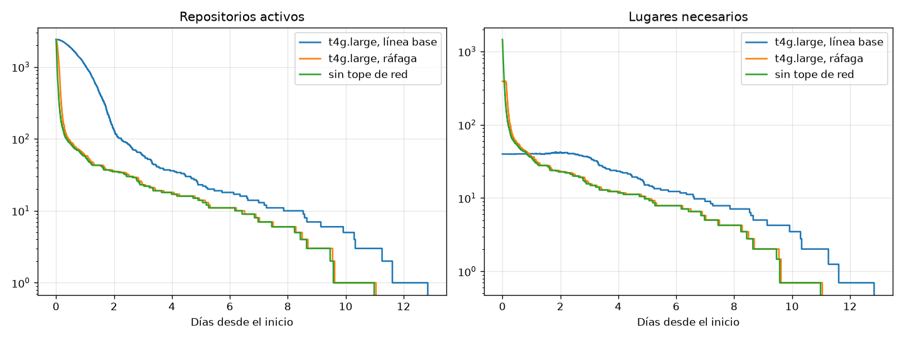

# Prueba de concurrencia: resultados

## Instancia

- **tipo:** t4g.large
- **zona:** sa-east-1a
- **vcpu:** 2
- **memoria_mb:** 7802
- **kernel:** 7.0.0-1014-aws
- **docker:** 29.1.3
- **servidor_simulado:** 172.31.15.96, 2 procesos
- **s3:** s3://prueba-concurrencia-mateo-sp
- **carga_web:** 450 MB, 0.1 núcleo

## Supuestos

- Velocidad por conexión: distinta para cada repositorio, log-normal con mediana 3,30 MB/s (desvío del logaritmo 1,01, cortada entre 0,3 y 6,0 veces la mediana), calibrada con la medición desde EC2 (15 repositorios: cuartiles 0,97 y 3,81 MB/s). Es el supuesto que más mueve la duración: ver el rango y la sensibilidad en la proyección.
- Archivos por ítem: 0,68 en promedio, medidos con `relevamiento medir-tamanos` en 11 repositorios (0: 3767, 1: 5899, 2: 241, 3: 26, 4: 37, 5: 30 de cada 10000 ítems); 38 % no tiene ninguno.
- Latencia hasta los encabezados: log-normal con p50 0.47 s y p95 1.9 s (pilotos).
- Archivos: log-normal con p50 1,20 MB y p95 25,9 MB, cortada en 1.876,6 MB: media 6,8 MB (medir-tamanos: 1.676 archivos de 11 repositorios, ponderado por sus ítems).
- Intervalo de cortesía: 1.0 s desde el fin de cada pedido.
- Versiones: python 3.12.16, aiohttp 3.14.5, plataforma Linux-7.0.0-1014-aws-aarch64-with-glibc2.41.

## Escenarios

Instancia simulada: **t4g.large** (2 vCPU, 8 GB, red base 61,0 MB/s). Valores sin el calentamiento; CPU en % de un núcleo.

| Esc. | Modo | Lugares | Repos | Tope de red (MB/s) | Pedidos/s | MB/s | CPU media | CPU máx | RSS máx (MB) | Bucle p99 (ms) | Despacho p99 (ms) | Lat. p50 (ms) | Lat. p95 (ms) | Errores | Violaciones | CPU servidor máx |
|---|---|---|---|---|---|---|---|---|---|---|---|---|---|---|---|---|
| t25-host | corrutinas + db | 25 | 2400 | 61,0 | 12,4 | 33,8 | 28,4 | 52,8 | 218,4 | 9,24 | 207.823,62 | 500,4 | 1.648,3 | 0 | 0 | 15,0 |
| t50-host | corrutinas + db | 50 | 2400 | 61,0 | 23,0 | 55,2 | 46,4 | 69,8 | 368,0 | 34,91 | 169.632,70 | 511,9 | 1.849,8 | 0 | 0 | 19,0 |
| t75-host | corrutinas + db | 75 | 2400 | 61,0 | 26,8 | 60,3 | 51,6 | 71,8 | 446,4 | 54,85 | 146.866,39 | 521,8 | 1.888,7 | 0 | 0 | 21,0 |
| t120-host | corrutinas + db | 120 | 2400 | 61,0 | 28,3 | 61,0 | 53,7 | 73,7 | 536,3 | 43,86 | 133.131,24 | 559,3 | 1.971,7 | 0 | 0 | 21,0 |
| t50-host-crt | corrutinas + db | 50 | 2400 | 61,0 | 23,0 | 55,0 | 47,5 | 72,7 | 345,0 | 24,71 | 169.786,06 | 536,3 | 1.938,6 | 0 | 0 | 19,0 |

Más detalle por escenario:

| Esc. | CPU sistema | CPU ms/pedido | CPU ms/MB | Hilos máx | Descriptores máx | Conexiones máx | Listos sin atender | GC ms/s | Steal % | Deriva RSS (MB/h) | DB tx/s | Commit p95 (ms) |
|---|---|---|---|---|---|---|---|---|---|---|---|---|
| t25-host | 6,8 | 22,90 | 8,40 | 7 | 276 | 245 | 2.361,6 | 0,72 | 0,65 | 810,0 | 1,0 | 3,45 |
| t50-host | 11,5 | 20,14 | 8,40 | 7 | 496 | 467 | 2.324,9 | 1,87 | 0,70 | 911,8 | 1,0 | 4,63 |
| t75-host | 12,9 | 19,24 | 8,56 | 7 | 627 | 580 | 2.295,2 | 2,81 | 0,66 | 1.251,1 | 1,0 | 5,64 |
| t120-host | 13,0 | 18,93 | 8,79 | 7 | 708 | 604 | 2.249,5 | 3,33 | 0,82 | 693,4 | 1,0 | 6,43 |
| t50-host-crt | 12,9 | 20,64 | 8,65 | 7 | 498 | 469 | 2.324,6 | 1,80 | 0,67 | 687,0 | 1,0 | 4,96 |

## Subida a S3

El motor guarda cada archivo mientras lo baja (los de menos de 8 MB en el spool en RAM, los demás en disco) y, al terminar, lo deja para un proceso subidor aparte (boto3, en su propio núcleo) que lo sube a un S3 falso local. Si lo pendiente pasa 256 MB en RAM o 4.096 MB en disco, el motor deja de repartir tareas nuevas ("frenado"). **Lo que importa: frenado en 0 y lo pendiente estable** quieren decir que la descarga nunca esperó a la subida.

| Esc. | Dónde sube | Lugares | Tope de red | MB/s bajados | MB/s subidos | CPU motor | CPU motor sin subida | RSS motor (MB) | CPU subidor (media / máx) | RSS subidor (MB) | Pendiente máx RAM / disco (MB) | Frenado (s) | Escritura a disco (MB/s) | Objetos (multipart) | Errores de subida | Pendiente al final (MB) |
|---|---|---|---|---|---|---|---|---|---|---|---|---|---|---|---|---|
| t25-host | proceso aparte (16) | 25 | 61,0 | 33,8 | 29,9 | 28,4 | — | 218 | 14,3 / 143,1 | 128 | 19 / 978 | 0,0 | 11,7 | 1047 (0) | 0 | 0 |
| t50-host | proceso aparte (16) | 50 | 61,0 | 55,2 | 44,6 | 46,4 | — | 368 | 22,1 / 90,2 | 127 | 29 / 178 | 0,0 | 20,2 | 1916 (0) | 0 | 0 |
| t75-host | proceso aparte (16) | 75 | 61,0 | 60,3 | 51,0 | 51,6 | — | 446 | 25,1 / 111,5 | 127 | 32 / 198 | 0,0 | 20,6 | 2274 (0) | 0 | 0 |
| t120-host | proceso aparte (16) | 120 | 61,0 | 61,0 | 52,0 | 53,7 | — | 536 | 25,3 / 67,4 | 125 | 35 / 152 | 0,0 | 34,6 | 2460 (0) | 0 | 0 |
| t50-host-crt | proceso aparte, CRT (16) | 50 | 61,0 | 55,0 | 44,0 | 47,5 | — | 345 | 17,9 / 74,1 | 254 | 26 / 196 | 0,0 | 22,8 | 1913 (0) | 0 | 0 |

- **Dónde sube:** proceso aparte (en su propio núcleo), un pool de hilos con s3transfer dentro del proceso del motor, o un pool de corrutinas con aiobotocore dentro del bucle del motor. Entre paréntesis, las subidas a la vez. El spool es el mismo en los tres: la única diferencia es dónde corre la subida.
- **CPU motor contra la referencia sin subida:** en proceso aparte, lo que le agrega al motor escribir el spool; con hilos o corrutinas, además todo el costo de subir, que comparte el núcleo (y el GIL) con la descarga. Si la CPU llega al 100 %, bajan los MB/s bajados y sube el retraso del bucle.
- **CPU del subidor:** solo se ve aparte en el proceso aparte. Con el SDK CRT de AWS sería menos.
- **Escritura a disco:** de toda la máquina; es lo que tiene que sostener el volumen EBS del spool (gp3 da 125 MB/s de base) y el tope de EBS de la instancia.
- En corridas cortas pasan sobre todo los archivos chicos: los grandes no llegan a terminar de bajar, así que el spool en disco aparece menos de lo que se usaría en la descarga real.

## Validación en una t4g.large real

El motor corre en una **t4g.large real**, en Docker Compose junto con PostgreSQL, y le pide a un servidor simulado que corre en **otra instancia** de la misma subred: el tráfico pasa por la placa de red real, el spool en disco escribe en el EBS real y todo comparte la memoria real de la máquina. La subida va a **S3 real**. La CPU y la memoria de la máquina incluyen todo lo que corre en ella (motor, subidor, PostgreSQL y Docker).

| Esc. | Corrutinas | Red de Docker | Base | Subida | MB/s bajados | MB/s subidos | CPU máquina (media / máx) | CPU motor (sistema) | Bucle p99 (ms) | Despacho p99 (ms) | Frenado (s) | Pendiente al final (MB) | Errores (descarga / subida) | Violaciones |
|---|---|---|---|---|---|---|---|---|---|---|---|---|---|---|
| t25-host | 25 | host | en lotes | S3 real | 33,8 | 29,9 | 31,4 / 92,2 | 28,4 (6,8) | 9,24 | 207.823,6 | 0,0 | 0 | 0 / 0 | 0 |
| t50-host | 50 | host | en lotes | S3 real | 55,2 | 44,6 | 45,2 / 71,8 | 46,4 (11,5) | 34,91 | 169.632,7 | 0,0 | 0 | 0 / 0 | 0 |
| t75-host | 75 | host | en lotes | S3 real | 60,3 | 51,0 | 50,4 / 85,0 | 51,6 (12,9) | 54,85 | 146.866,4 | 0,0 | 0 | 0 / 0 | 0 |
| t120-host | 120 | host | en lotes | S3 real | 61,0 | 52,0 | 54,7 / 90,0 | 53,7 (13,0) | 43,86 | 133.131,2 | 0,0 | 0 | 0 / 0 | 0 |
| t50-host-crt | 50 | host | en lotes | S3 real (CRT) | 55,0 | 44,0 | 45,3 / 92,0 | 47,5 (12,9) | 24,71 | 169.786,1 | 0,0 | 0 | 0 / 0 | 0 |

| Esc. | Memoria disponible mín (MB) | Pico contenedor motor (MB) | Pico PostgreSQL (MB) | Pico API y frontend (MB) | RSS motor máx (MB) | RSS subidor máx (MB) | Escritura a disco (media / máx, MB/s) | DB tx/s (filas/s) | Commit p95 (ms) | Deriva memoria disponible (MB/h) |
|---|---|---|---|---|---|---|---|---|---|---|
| t25-host | 6.311 de 7.802 | 356 | 40 | 455 | 218 | 128 | 11,7 / 97,7 | 1,0 (12,3) | 3,45 | — |
| t50-host | 6.178 de 7.802 | 501 | 42 | 455 | 368 | 127 | 20,2 / 198,2 | 1,0 (23,1) | 4,63 | — |
| t75-host | 6.086 de 7.802 | 591 | 41 | 455 | 446 | 127 | 20,6 / 232,0 | 1,0 (27,0) | 5,64 | — |
| t120-host | 5.984 de 7.802 | 698 | 41 | 455 | 536 | 125 | 34,6 / 236,0 | 1,0 (28,4) | 6,43 | — |
| t50-host-crt | 5.920 de 7.802 | 628 | 41 | 455 | 345 | 254 | 22,8 / 150,5 | 1,0 (23,0) | 4,96 | — |

**Créditos de CPU de la t4g.large.** Sin cargo extra, sostiene en promedio el 30 % de la máquina (0,6 núcleos). Por encima, en modo Unlimited, cobra USD 0,04 por hora de vCPU. Lo de abajo es durante el pico; pasado el pico la CPU baja con los MB/s.

| Esc. | Corrutinas | MB/s bajados | MB/s por corrutina | CPU máquina media | Línea base | Exceso (núcleos) | Cargo extra (USD por día de pico) |
|---|---|---|---|---|---|---|---|
| t25-host | 25 | 33,8 | 1,35 | 31,4 % | 30 % | 0,03 | 0,03 |
| t50-host | 50 | 55,2 | 1,10 | 45,2 % | 30 % | 0,30 | 0,29 |
| t75-host | 75 | 60,3 | 0,80 | 50,4 % | 30 % | 0,41 | 0,39 |
| t120-host | 120 | 61,0 | 0,51 | 54,7 % | 30 % | 0,49 | 0,47 |
| t50-host-crt | 50 | 55,0 | 1,10 | 45,3 % | 30 % | 0,31 | 0,29 |

- **Red de Docker:** `puente` es la red por defecto de Docker (cada paquete pasa por una interfaz virtual y NAT); `host`, el motor usa la red de la máquina directamente. La diferencia de CPU es lo que cuesta el puente.
- **Base:** `por resultado`, una transacción por resultado que el lugar espera antes de tomar otra tarea; `en lotes`, como el descargador, el lugar encola y sigue, y una tarea aparte escribe lo encolado cada 1 s. **Subida (CRT):** el cliente de S3 de AWS escrito en C en vez de s3transfer.
- **CPU máquina:** % de toda la instancia (en una de 1 vCPU, 100 % es el núcleo entero). Es lo que importa para saber si entra todo: motor, subidor, PostgreSQL y Docker.
- **Memoria disponible mínima:** la que le quedó libre a la máquina en el peor segundo. El pico del contenedor del motor incluye el spool en RAM (`/dev/shm`) y el subidor; el de PostgreSQL, sus buffers.
- **Escritura a disco:** del EBS real. Si se acerca al tope de EBS de la instancia (o a los 125 MB/s de base de un gp3), el spool en disco se atrasa y lo pendiente crece; en corridas cortas cuenta la ráfaga de EBS.
- **Deriva:** solo en corridas de 10 minutos o más (la de 1 hora). Negativa quiere decir que la memoria disponible baja; el caché de páginas del disco también la baja sin que sea una pérdida.

## Proyección al problema real

2400 repositorios y 6 M de ítems repartidos con la regla del simulador del descargador: el repositorio más grande tiene 219,286 ítems, la mediana es 596 y el 4 % más grande concentra el 66,6 %.

Modelo calibrado (cuentas):

- Resolución: latencia media 0,67 s. Descarga: latencia + archivo medio / ancho = 2,64 s. Medido en el escenario de referencia: resolución 0,00 s y descarga 0,00 s.
- Un ítem son 1 resolución y 0,68 descargas: con 1.0 s de cortesía después de cada pedido, a la velocidad mediana ocupa al repositorio 4,1 s y baja 4,7 MB.
- Total a bajar: 28,1 TB.
- **Pico** (todos los repositorios activos): 948 pedidos/s, 2.527 MB/s de demanda y unos 1.452 pedidos en curso.
- **Repositorios:** todos con la regla de reparto y una velocidad sorteada.
- **Cota por cortesía:** el repositorio que más tarda solo (grande y lento: 170,340 ítems a 1,58 MB/s) tarda **11,0 días**, haya una máquina o cien. El más grande (219,286 ítems) a la velocidad mediana tardaría 10,5.
- **Cota por red (t4g.large, línea base, 61,0 MB/s):** 28,1 TB / red = **5,1 días**. CPU que pide procesar esa red a 8,79 ms de CPU por MB: 0,54 núcleos.
- **Cota por red (t4g.large, ráfaga, 596,0 MB/s):** 28,1 TB / red = **0,5 días**. CPU que pide procesar esa red a 8,79 ms de CPU por MB: 5,24 núcleos.

Distribuir solo ayuda si un proceso no llega a procesar lo que da la red de la instancia; si llega, el límite es la red, y se resuelve con una instancia de más red.

### A lo largo de toda la descarga

Modelo de fluido con la distribución de ítems y una velocidad para cada repositorio: cada uno avanza al ritmo de su cortesía o, si la red no alcanza, a la parte de la red que le toca (los que piden menos que su parte se llevan lo que piden); los chicos y rápidos terminan primero. Lugares necesarios: los que pide la cortesía (a la velocidad mediana, cada repositorio está ocupado 2,46 s de cada 4,13 s) o los que llenan la red, lo que sea menor.

**La duración es un rango:** depende de qué repositorios grandes salen lentos. Con 30 sorteos distintos de velocidades:

| Red | Percentil 10 (días) | Mediana (días) | Percentil 90 (días) |
|---|---|---|---|
| t4g.large, línea base | 11,8 | 15,5 | 20,0 |
| sin tope de red | 9,8 | 13,7 | 18,3 |

La tabla de abajo es un solo sorteo (el de la semilla de la prueba).

| Red | Duración (días) | Lugares que llenan la red | Día 0: activos / lugares / MB/s | Día 1: activos / lugares / MB/s | Día 7: activos / lugares / MB/s | Día 14: activos / lugares / MB/s | Día 30: activos / lugares / MB/s | Día 60: activos / lugares / MB/s |
|---|---|---|---|---|---|---|---|---|
| t4g.large, línea base | 12,8 | 42 | 2400 / 40 / 61,0 | 1065 / 40 / 61,0 | 13 / 9 / 10,6 | terminó | terminó | terminó |
| t4g.large, ráfaga | 11,0 | 394 | 2400 / 389 / 596,0 | 59 / 37 / 58,9 | 8 / 6 / 5,9 | terminó | terminó | terminó |
| sin tope de red | 11,0 | — | 2400 / 1.452 / 2.527,4 | 58 / 36 / 57,7 | 7 / 5 / 5,3 | terminó | terminó | terminó |

### Sensibilidad a la velocidad por conexión

Como cada repositorio recibe un pedido a la vez, si sus archivos llegan más lento avanza más lento: ninguna máquina ni más red compensa eso. Con la red de la t4g.large, moviendo la mediana (cada repositorio sigue con su velocidad relativa):

| Mediana MB/s por conexión | Tiempo por ítem a la mediana (s) | Repositorio que más tarda (días) | Duración total (días) | Corrutinas que llenan la red |
|---|---|---|---|---|
| 0,5 | 11,6 | 42,4 | 43,3 | 181 |
| 1,0 | 7,2 | 23,5 | 25,0 | 102 |
| 2,1 | 4,8 | 13,9 | 15,6 | 57 |
| 3,3 ← esta corrida | 4,1 | 11,0 | 12,8 | 42 |
| 5,0 | 3,7 | 9,1 | 11,1 | 33 |

### Instancias candidatas

Para cada instancia, con su red base: duración del modelo, corrutinas que llenan la red, MB/s al principio, CPU que pide procesarlos (8,79 ms de CPU por MB, medidos en el escenario t120-host en la máquina de esta corrida: vale para ese mismo tipo de procesador), memoria según el barrido y costo on-demand en us-east-1 por toda la descarga. Precios y redes de config.INSTANCIAS: verificar antes de decidir.

| Instancia | vCPU / RAM | Red base (MB/s) | $/h | Duración (días) | Corrutinas | MB/s | CPU (% de un núcleo) | Memoria (MB) | Costo total |
|---|---|---|---|---|---|---|---|---|---|
| t3.small | 2 / 2 GB | 15,3 | 0,0208 | 24,4 | 12 | 15,3 | 13,4 | — | $12 |
| t3.medium | 2 / 4 GB | 30,5 | 0,0416 | 16,0 | 22 | 30,5 | 26,8 | — | $16 |
| t3.large | 2 / 8 GB | 61,0 | 0,0832 | 12,8 | 42 | 61,0 | 53,7 | — | $26 |
| t3.xlarge | 4 / 16 GB | 122,1 | 0,1664 | 11,7 | 84 | 122,1 | 107,3 ⚠ | — | $47 |
| t4g.medium | 2 / 4 GB | 30,5 | 0,0336 | 16,0 | 22 | 30,5 | 26,8 | — | $13 |
| t4g.large ← | 2 / 8 GB | 61,0 | 0,0672 | 12,8 | 42 | 61,0 | 53,7 | — | $21 |
| c7g.medium | 1 / 2 GB | 62,0 | 0,0363 | 12,8 | 43 | 62,0 | 54,5 | — | $11 |
| c7g.large | 2 / 4 GB | 111,7 | 0,0725 | 11,8 | 77 | 111,7 | 98,2 ⚠ | — | $21 |
| c6i.large | 2 / 4 GB | 93,1 | 0,0850 | 12,0 | 64 | 93,1 | 81,9 ⚠ | — | $25 |
| c6gn.medium | 1 / 2 GB | 190,7 | 0,0432 | 11,4 | 128 | 190,7 | 167,7 ⚠ | — | $12 |
| c6gn.large | 2 / 4 GB | 357,6 | 0,0864 | 11,1 | 236 | 357,6 | 314,5 ⚠ | — | $23 |
| c7gn.medium | 1 / 2 GB | 372,5 | 0,0624 | 11,1 | 246 | 372,5 | 327,6 ⚠ | — | $17 |

⚠: la CPU que pide pasa lo que la instancia sostiene (línea base de créditos en las t3; 80 % de un núcleo en las demás, porque un proceso de Python usa uno solo).

## Criterio de decisión

| Escenario | Condición | Resultado |
|---|---|---|
| 4 | Cero violaciones de cortesía y cero errores | sin datos |
| 4 | Retraso de despacho p99 < 100 ms | sin datos |
| 4 | Retraso del bucle p99 < 50 ms | sin datos |
| 4 | CPU media dentro de la línea base de la t4g.large (60 % de un núcleo) | sin datos |
| 4 | RSS máxima < 4096 MB | sin datos |
| 4 | El servidor simulado no fue el límite | sin datos |
| 9 | Cero violaciones de cortesía y cero errores | sin datos |
| 9 | Retraso de despacho p99 < 100 ms | sin datos |
| 9 | Retraso del bucle p99 < 50 ms | sin datos |
| 9 | CPU media dentro de la línea base de la t4g.large (60 % de un núcleo) | sin datos |
| 9 | RSS máxima < 4096 MB | sin datos |
| 9 | El servidor simulado no fue el límite | sin datos |
| 9 | Memoria estable: deriva < 10% de la RSS media por hora | sin datos |

## Conclusión

_Completar a mano con los números de arriba: si alcanza un proceso con corrutinas, en qué instancia, qué recurso se agota primero y cómo se comparan las corrutinas con los hilos._
